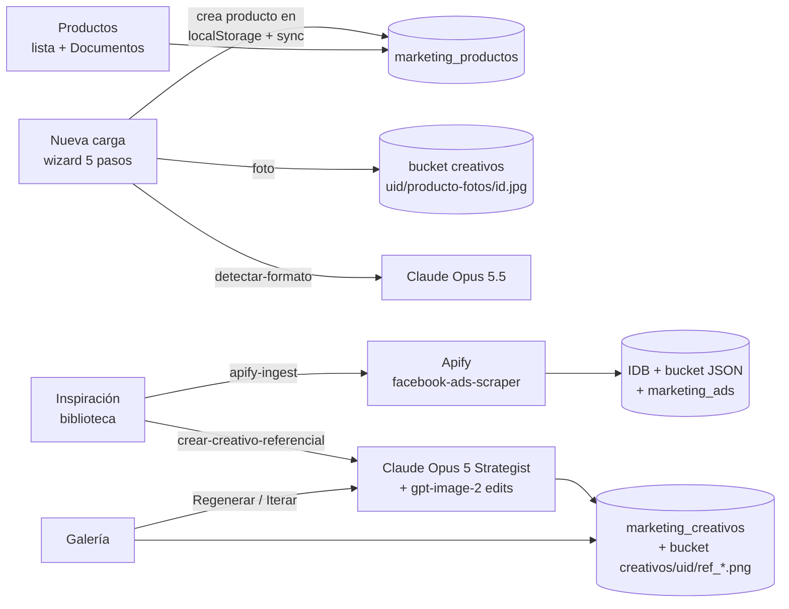
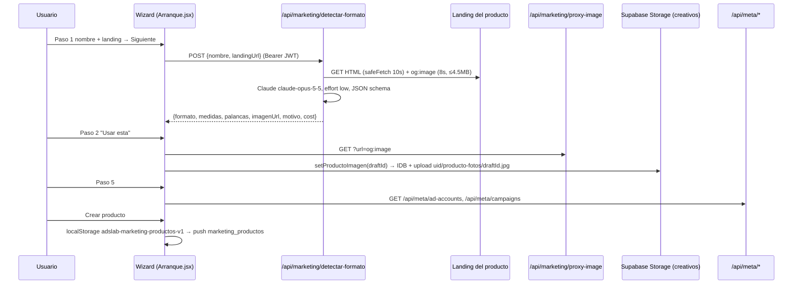
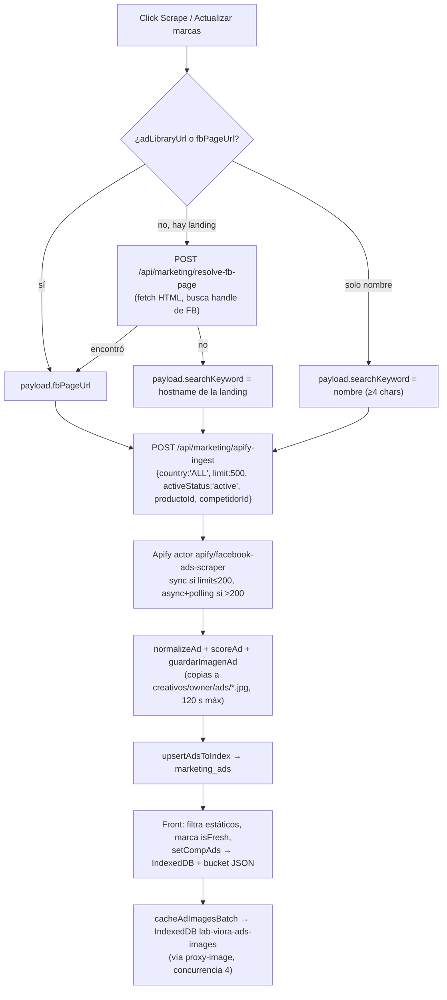
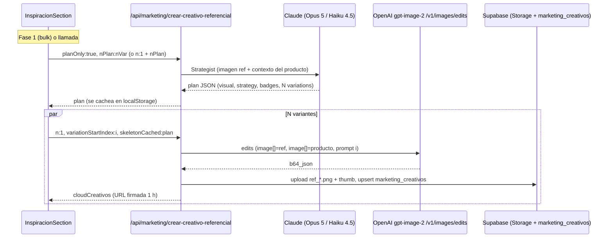

# Estáticos: cómo funciona hoy (guía de migración a Kombialo · Next.js 16 + TypeScript)

> Documento armado leyendo el código de `dash-laboratorio` (React 18 + Vite en `src/`, funciones serverless de Vercel en `api/`, Supabase). Describe el comportamiento **actual**, no el deseado. Donde el código es ambiguo o se contradice, lo digo explícitamente con la etiqueta **⚠ No está claro**.
>
> Convención: los paths son relativos a la raíz del repo. No se incluyen claves, URLs de Supabase ni datos de clientes; sí nombres de variables de entorno, tablas, buckets y claves de `localStorage`.

## Índice

1. [Mapa general](#1-mapa-general)
2. [Piezas compartidas (sync, visibilidad, costos, seguridad, Supabase server)](#2-piezas-compartidas)
3. [Pantalla: Nueva carga (`mk-nueva-carga`)](#3-pantalla-nueva-carga-mk-nueva-carga)
4. [Pantalla: Productos (`mk-arranque`)](#4-pantalla-productos-mk-arranque)
5. [Pantalla: Inspiración (`mk-inspiracion`)](#5-pantalla-inspiración-mk-inspiracion)
6. [Pantalla: Galería (`mk-galeria`)](#6-pantalla-galería-mk-galeria)
7. [El pipeline de un estático, paso a paso (`crear-creativo-referencial`)](#7-el-pipeline-de-un-estático-paso-a-paso)
8. [Cuánto cuesta en IA cada estático generado](#8-cuánto-cuesta-en-ia-cada-estático-generado)
9. [Inventario de datos: tablas, buckets, IndexedDB y localStorage](#9-inventario-de-datos)
10. [Notas para pasar a Next.js + TypeScript](#10-notas-para-pasar-a-nextjs--typescript)
11. [Anexo: prompts completos](#11-anexo-prompts-completos)

---

## 1. Mapa general

El grupo de menú **"Estáticos"** está en `src/App.jsx` (líneas ~2547-2551). Las cuatro entradas se renderizan solo si `currentUser.role === 'admin'`, plataforma `marketing` y hay sesión de Supabase (o Supabase no está configurado):

| Menú | `section` | Componente | Props |
|---|---|---|---|
| Nueva carga | `mk-nueva-carga` | `src/Arranque.jsx` (`ArranqueSection`) | `modoAlta` |
| Productos | `mk-arranque` | `src/Arranque.jsx` (`ArranqueSection`) | — |
| Inspiración | `mk-inspiracion` | `src/InspiracionGeneral.jsx` → `src/InspiracionSection.jsx` | `forcedProductoId`, `embedded`, `biblioteca` |
| Galería | `mk-galeria` | `src/GaleriaGeneral.jsx` → `src/GaleriaReferencialesModal.jsx` | `productoId`, `producto`, `embedded` |

La sección activa se persiste en el estado de `App.jsx` (lista blanca `validSections`, línea ~1501). `mk-competencia` (vieja) redirige a `mk-arranque`.



---

## 2. Piezas compartidas

### 2.1 Productos: localStorage como caché + sync a Supabase (`src/marketingSync.js`, `src/useMarketingSync.js`)

- **Fuente de lectura sincrónica:** `localStorage['adslab-marketing-productos-v1']` (array de productos, cada uno un objeto JSON libre). Todas las pantallas de Estáticos leen de acá.
- **Push:** cada escritura dispara el evento `viora:marketing-storage-changed`; `useMarketingSync` hace push con **debounce de 2 s**. `pushAllProductos`/`pushProducto` hacen `upsert` en `marketing_productos` (`id`, `user_id`, `data` JSON, `updated_at`; conflicto `user_id,id`).
  - Guardas: no pushea un array vacío; **anti-wipe** (no pisa si lo local pesa <50% que lo del cloud y no es más nuevo); **LWW** por `updated_at`; tombstones `_deleted`.
  - `stripIdeas` saca `bandejaIdeas` (viven en `marketing_ideas`) y `competidores[].ads` (viven en IndexedDB + bucket) antes de subir.
- **Pull:** al login (`pullMarketingFromCloud`) trae `marketing_productos`, `marketing_prefs` (`gen_opts` → `localStorage['adslab-marketing-gen-opts']`; `active_producto_id` ya **no** se aplica) y `marketing_brands` (→ `localStorage['adslab-marketing-inspiracion-brands-<productoId>']`). Dispara `viora:marketing-pulled`. También hay un canal **realtime** que dispara pulls (ver comentario en `marketingSync.js` sobre el loop de escrituras del 14-09-2026).
- Si el `localStorage` se llena, libera cachés descartables (`adslab-marketing-skeleton-cache`, `...-creative-refresh-cache`, `...-execution-log`, `...-cost-log`, prefijos `adslab-meta-cache-`, `backup-`, `adslab-marketing-copilot-`, `adslab-creativo-img-cache`, brands) y reintenta.
- "Dueño efectivo": para cuentas miembro (`cuenta_miembros`), los datos se leen/escriben con el `user_id` del dueño (`ownerEfectivo` de `src/miembroStore.js`).

### 2.2 Visibilidad (`src/productosVisibles.js`)

`soloVisibles(productos)` filtra los productos cuyo `responsable` (en minúsculas) está en `RESPONSABLES_OCULTOS` (hoy un solo valor hardcodeado). **No borra** nada: es un filtro de UI. Lo usan Inspiración (lista "Crear para" y armado de la biblioteca), Galería y la lista de Productos.

### 2.3 Costos (`api/marketing/_costs.js` + `src/costsStore.js`)

- `anthropicCost(usage, model)`: precio por 1M tokens según regex sobre el nombre del modelo:
  - `/opus/` → input **$5**, output **$25**, cache write $6.25, cache read $0.50.
  - `/haiku/` → input $1, output $5, write $1.25, read $0.10.
  - resto (Sonnet) → input $3, output $15, write $3.75, read $0.30.
- `whisperCost(seg)`: $0.006/min.
- `gptImageCost(usage | {size, quality})`: text in $5/M, image in $10/M, image out $40/M; con tabla de tokens de salida por size×quality. **⚠ No se usa en ningún endpoint** (ver §8).
- Cada endpoint devuelve `cost: { anthropic, openai, apify }`; el front lo registra con `logCostsFromResponse` en `localStorage['adslab-costs-log-v1']` y lo sube a la tabla `marketing_costs` (`pushUnsyncedCostsToCloud`).

### 2.4 Seguridad (`api/marketing/_security.js`)

- `isAllowedRemoteHost(url)`: bloquea IPs privadas/loopback/link-local y exige una allowlist de CDNs (fbcdn, cdninstagram, amazonaws, cloudfront, googleusercontent, supabase.co, shopify, tiendanube, mlstatic, etc.).
- `safeFetch(url, init, {timeoutMs})`: si el host no está en la allowlist pero no es IP privada, **igual lo deja pasar** con timeout recortado a 5 s ("soft-fallback").
- `requireAuth(req, res, getUserIdFromAuth)`: 401 si no hay `Authorization: Bearer <jwt de Supabase>` válido.

### 2.5 Supabase server (`api/marketing/_supabase-server.js`)

- Env vars: `SUPABASE_URL`, `SUPABASE_SERVICE_KEY` **o** `SUPABASE_SERVICE_ROLE_KEY`, `AUTH_SECRET` (cifrado AES-256-GCM de tokens de Meta).
- `getUserIdFromAuth(req)`: `supabase.auth.getUser(token)` con el JWT del header.
- `uploadCreativoToBucket(userId, refId, b64)`: sube a bucket **`creativos`** en `<userId>/<refId>.png` + miniatura `<userId>/<refId>_thumb.jpg` (sharp, 480 px, JPEG q72).
- `guardarImagenAd(sb, ownerId, adId, url)`: copia permanente del ad scrapeado en `creativos/<owner>/ads/<adId>.jpg` (sharp, 640 px, q74).
- `createSignedUrlsForCreativos(paths, 3600)`: firma URLs (1 h).
- `insertCreativoRow(row)`: `upsert` en `marketing_creativos` (`onConflict: 'user_id,id'`).
- `readProductoDocs` / `patchProductoDocs`: leen/mergean `marketing_productos.data.docs`.

**Bucket `creativos`: en producción es PÚBLICO** (`storage.buckets.public = true`, verificado en la base el 2026-10-22). El código se contradice en los comentarios: `_supabase-server.js` (firma de URLs), `src/productoImagen.js` y `src/galeriaReferencialesCloud.js` lo tratan como privado y firman URLs de 1 h; `guardarImagenAd` y `src/adImagenes.js` arman a mano `…/storage/v1/object/public/creativos/<owner>/ads/<adId>.jpg`. Las dos cosas funcionan porque es público (las políticas RLS de `storage.objects` solo limitan subir/borrar/listar a la carpeta del dueño; ver `docs/adslab-esquema.sql`). Cualquiera con la URL puede ver un archivo: decidir en Kombialo si se mantiene así o se pasa a privado con URLs firmadas.

---

## 3. Pantalla: Nueva carga (`mk-nueva-carga`)

### 3.1 Qué ve el usuario

`ArranqueSection` con `modoAlta=true`. Al entrar, un `useEffect` abre directamente el **wizard "Nuevo producto"** (salvo que venga de "Editar setup", ver 3.4). Encabezado de pasos: **1 El producto · 2 Foto · 3 Formato · 4 Ofertas · 5 Conexiones**. Botones: Cancelar, ← Atrás, Siguiente →, y en el paso 5 **Crear producto**.

| Paso | Qué se carga | Notas de comportamiento |
|---|---|---|
| 1. El producto | Nombre (obligatorio) y URL de la landing | Al tocar "Siguiente" sin formato elegido, dispara **`detectarFormato`** en background (IA). |
| 2. Foto | `ProductoImagenUploader` (subir archivo) | Si `detectar-formato` encontró `og:image`, muestra la miniatura (vía `/api/marketing/proxy-image`) y un botón **"Usar esta"**: baja la imagen por el proxy, la comprime (`comprimirImagen`: máx 1024 px, JPEG 0.85, fondo blanco) y la guarda con el **ID reservado** del producto (`draftId = prod-<ts>-<rand>`), antes de que el producto exista. |
| 3. Formato | Select `FORMATOS_PRODUCTO` (22 opciones + vacío) y texto libre "Tamaño real / medidas" | Botón "Detectar con IA" (vuelve a llamar a `detectar-formato`). Muestra el `motivo` devuelto. Si el usuario ya escribió medidas no se pisan. |
| 4. Ofertas | Checklist `PALANCAS_OFERTA` (precio, descuento, combo, cuotas, envío, garantía, regalo, urgencia), cada una con su texto, + textarea "Otra oferta o claim" | Las palancas vienen pre-marcadas por la IA (`palancas[k].tiene/texto`) si el usuario no las tocó. Al pasar al 5: carga cuentas de Meta si hay conexión, y propone palabra clave (primera palabra ≥4 letras del nombre). |
| 5. Conexiones | Palabras clave de campañas (CSV), cuenta publicitaria (opcional), campaña base (opcional), break-even (default `1.60`) | Cuentas de `GET /api/meta/ad-accounts`; campañas de `GET /api/meta/campaigns?account_id=…` (máx 60 en el select). |
| (6. Competencia) | — | Existe en el código pero **deshabilitado**: `{false && wizPaso === 6 && …}`. Por eso `wizCx.comp1/comp2` quedan vacíos y `competidores` nace `[]`. |

**Crear producto** (`handleAddProducto`, `src/Arranque.jsx` ~1920) arma el objeto y lo agrega al principio de `productos` (state → `saveJSON(PRODUCTOS_KEY)` → evento → push a `marketing_productos`):

```js
{
  id: draftId, nombre, landingUrl, descripcion: '',
  formato?, medidas?,
  ofertasReales?: "<texto de cada palanca marcada (o su label)>\n…\n<otra oferta>",
  palancas?: { precio: {on, texto}, … },
  palabrasClave?: ['…'],
  competidores: [],
  createdAt,
  metaAccount?: { id, name, currency, connId, ads: [], fetchedAt: null },
  campanaBase?: { id, name },
  breakEven?: number,
}
```

Después deja ese producto activo y queda en el **setup** (3.3).

### 3.2 Flujo



### 3.3 El setup que sigue (Nueva carga con producto activo)

Con `modoAlta` y un producto activo se muestran tarjetas `WizardCard`:

1. **Tu producto**: nombre y landing editables (`ProductoNombreEditable`, `ProductoLandingEditable`), estado del research doc, `ProductoImagenUploader` (foto + extracción de paleta con `src/extractPalette.js` → `producto.accentColor`), `<details>` de **Formato** y **Medidas**, `<details>` de **Ofertas reales** (textarea libre que escribe `producto.ofertasReales`).
2. **Seguimiento en Meta Ads**: palabras clave, cuentas del producto, "Cargar mis cuentas", seleccionar cuenta → `GET /api/meta/ads-with-insights?account_id=…&limit=50&date_preset=last_7d` y guarda `producto.metaAccount.ads`; botón **matcher IA** → `POST /api/marketing/match-product-ads` (Claude Sonnet 4.6) que marca qué ads son del producto; preset de "campaña base" (`PublicarCampanaModal`, fuera de alcance de esta guía).
3. **Competencia** y **Analizar y generar ideas**: ocultas (`MOSTRAR_IDEAS = false`).

Renombrar el producto o cambiar la landing, **si ya existe `docs.research`**, ofrece regenerar los docs → `runPipeline({ docsOnly: true })` → `POST /api/marketing/generate` (SSE; Claude Sonnet 4.6 para research + Haiku 4.5 para avatar/offer brief/creencias/resumen). Es el único camino visible hoy que genera `docs.*`; **un producto nuevo no obtiene research** porque el pipeline completo está oculto.

### 3.4 Archivos

- `src/App.jsx` (menú y render), `src/Arranque.jsx` (wizard: `FORMATOS_PRODUCTO` ~180, `PALANCAS_OFERTA` ~209, `detectarFormato` ~1486, `usarFotoLanding` ~1534, `cargarCampanasWizard` ~1551, `loadAdAccounts` ~1804, `selectAccount` ~1841, `matchProductAds` ~1871, `handleAddProducto` ~1920, UI del wizard ~3369-3596, setup ~4258+).
- `src/ProductoImagenUploader.jsx`, `src/productoImagen.js` (`setProductoImagen`, `getProductoImagen`, `comprimirImagen`, `getAccentColor`), `src/extractPalette.js`.
- `src/MetaConnect.jsx` (`useMetaConnections`, `authHeaders`).
- `api/marketing/detectar-formato.js`, `api/marketing/proxy-image.js`, `api/marketing/match-product-ads.js`, `api/meta/[action].js` (`ad-accounts`, `campaigns`, `ads-with-insights`), `api/marketing/generate.js` (solo regen de docs).
- "Editar setup" desde Productos guarda `localStorage['adslab-setup-producto'] = id` y navega a `mk-nueva-carga`; el `useEffect` de `modoAlta` lo lee, lo borra y abre el setup de ese producto en vez del wizard.

### 3.5 Datos que lee/escribe

| Tipo | Nombre | R/W | Para qué |
|---|---|---|---|
| localStorage | `adslab-marketing-productos-v1` | R/W | Producto nuevo y edición del setup |
| localStorage | `adslab-marketing-active-product` | R/W | Producto activo |
| localStorage | `adslab-setup-producto` | R (y borra) | Abrir setup de un producto existente |
| localStorage | `adslab-marketing-competidores-v1`, `adslab-marketing-meta-account-v1` | R (y borra) | Migración legacy al primer producto |
| localStorage | `adslab-marketing-gen-config-v1`, `adslab-marketing-run-history-v1`, `adslab-marketing-last-pipeline-run-v1`, `adslab-marketing-pipeline-running-v1`, `adslab-flow-guide-open`, `adslab-marketing-prod-tab-<id>` | R/W | Config/estado del pipeline oculto y UI |
| IndexedDB | `adslab-producto-imagenes` / store `imagenes` | R/W | Foto del producto (data URL) |
| Storage | `creativos/<uid>/producto-fotos/<productoId>.jpg` | W/R | Foto del producto (cross-device). Se lee por SDK `download` (no por URL pública). |
| Tabla | `marketing_productos` | W (push) / R (pull, fallback de foto) | Producto |
| Tabla | `marketing_costs` | W | Log de costos (detectar-formato, match) |
| Tabla | `meta_connections` (vía `/api/meta/*`) | R | Token de Meta por conexión |

### 3.6 Llamadas externas

| Servicio | Endpoint propio | Detalle |
|---|---|---|
| **Claude** | `POST /api/marketing/detectar-formato` | Modelo **`claude-opus-5-5`**, `max_tokens: 4000`, `output_config: { effort: 'low', format: { type: 'json_schema', … } }`. Entrada: imagen `og:image` en base64 (si se pudo bajar) + prompt con título, descripción y hasta 9.000 caracteres de texto plano de la landing. Salida: `formato` (enum), `medidas`, `palancas{precio…urgencia:{tiene,texto}}`, `motivo`. Requiere auth. `maxDuration` 60 s. |
| Landing (HTTP) | idem | `safeFetch` con UA `Mozilla/5.0 (Kombialo)`, 10 s. |
| Proxy | `GET /api/marketing/proxy-image?url=` | Solo hosts fbcdn/cdninstagram/facebook/instagram/whatsapp/amazonaws/apify; rechaza no-imagen, >10 MB y <512 bytes; `Cache-Control: public, max-age=86400, immutable`; sin auth. **⚠** La `og:image` de una landing propia casi nunca está en esa allowlist → "Usar esta" probablemente falle con 403 para muchas tiendas (el endpoint `detectar-formato` sí la baja porque usa `safeFetch`). |
| **Meta Graph** (`v21.0`) | `GET /api/meta/ad-accounts` | `me/adaccounts` (fields `id,account_id,name,account_status,currency,timezone_name,business_name`, limit 100, paginado) + `me/businesses` → `{bizId}/owned_ad_accounts` y `{bizId}/client_ad_accounts`. |
| Meta Graph | `GET /api/meta/campaigns` | `{act_id}/campaigns` fields `id,name,objective,status,effective_status,created_time`, limit 100, hasta ~3 páginas. |
| Meta Graph | `GET /api/meta/ads-with-insights` (setup) | `{act_id}/ads` con `campaign{…}`, `adset{…}`, `creative{…}` y dos `insights.time_range(...)` (recent/previous); `effective_status` ACTIVE/PAUSED. |
| **Claude** | `POST /api/marketing/match-product-ads` (setup) | `claude-sonnet-4-6`, `max_tokens: 4000`, system con `cache_control: ephemeral`; hasta 100 ads (name/title/body ≤400). |
| **Claude** | `POST /api/marketing/generate` (solo regen de docs) | `claude-sonnet-4-6` (research, `max_tokens` 8192) + `claude-haiku-4-5-20251001` (descripción 256, avatar 4096, offer brief 4096, creencias 2048, resumen 512). Prompts en `api/marketing/_lib.js` (no copiados en el anexo; ver §11.9). |

---

## 4. Pantalla: Productos (`mk-arranque`)

### 4.1 Qué ve el usuario

- **Lista** de productos visibles (`soloVisibles`), en grilla o lista (`localStorage['adslab-productos-vista']`), con guía "¿Cómo funciona?" (3 pasos: Nueva carga → Inspiración → Galería). Cada card muestra: avatar con la foto (`getProductoImagen`), métricas de creativos (Creados/Descargados/Pendientes/Archivados vía `countReferencialesAllProductos` → `marketing_creativos`), gasto acumulado (local `adslab-costs-log-v1` + `marketing_costs` de las últimas 5.000 filas), responsable asignable, modales de costos (`ProductoCostsModal` → `marketing_costs`) e historial (`ProductoHistorialModal` → `marketing_creativos` + `marketing_costs`). Menú "•••": Diagnóstico de sync e Importar producto desde JSON (`src/productoExport.js`). Botón "Nuevo producto" navega a `mk-nueva-carga`.
- **Detalle del producto** (al hacer click): header con "Editar setup" y **una sola pestaña visible: Documentos** (`DocumentacionTab`, muestra/edita/descarga los 5 docs `resumenEjecutivo`, `research`, `avatar`, `offerBrief`, `beliefs` de `producto.docs`; si no hay, un empty state). Las pestañas Creativos y Guiones están comentadas; Bandeja, Inspiración, Galería, Setup, Competencia y Campañas están en la lista `REMOVED` y caen a Documentos. `MOSTRAR_IDEAS = false` oculta la generación de ideas y la tarjeta de Competencia.
- Eventos `viora:product-tab` con `galeria` o `inspiracion` redirigen a las secciones del menú (`mk-galeria` / `mk-inspiracion`), guardando `adslab-galeria-producto`.

### 4.2 Archivos

`src/Arranque.jsx` (lista ~3598-4140, workspace ~4150-4257, `ProductTabs` ~710), `src/DocumentacionTab.jsx`, `src/ProductoCostsModal.jsx`, `src/ProductoHistorialModal.jsx`, `src/DiagnosticoSyncModal.jsx`, `src/productoExport.js`, `src/costsStore.js`, `src/galeriaReferenciales.js`, `src/marketingSync.js` (`deleteProducto` borra en `marketing_brands`, `marketing_creativos` y `marketing_productos`).

### 4.3 Datos

| Tipo | Nombre | R/W |
|---|---|---|
| localStorage | `adslab-marketing-productos-v1`, `adslab-marketing-active-product`, `adslab-marketing-prod-tab-<id>`, `adslab-productos-vista`, `adslab-costs-log-v1`, `adslab-costs-backfill-v1`, `adslab-marketing-inspiracion-brands-<id>` (solo lectura para backfill de costos) | R/W |
| Tablas | `marketing_productos` (sync), `marketing_creativos` (conteos, historial, borrado), `marketing_costs` (gasto), `marketing_brands` (borrado) | R/W |
| IndexedDB | `adslab-producto-imagenes`, `lab-viora-referenciales` (conteos locales), `adslab-competidor-ads-v1` (hidratación de ads de competidores) | R |

### 4.4 Llamadas externas

Ninguna llamada a IA desde la lista ni desde Documentos (la edición de docs es local). `/api/meta/*` y `match-product-ads` solo si se entra al setup (sección 3).

---

## 5. Pantalla: Inspiración (`mk-inspiracion`)

### 5.1 Qué ve el usuario

**Paso 1 (`src/InspiracionGeneral.jsx`):** "¿Para qué producto vas a crear?" — grilla de productos visibles ordenados por fecha de alta, y un select "Crear para" arriba a la derecha. La elección vive en `sessionStorage['adslab-inspiracion-destino']`. Banner de ayuda de 3 pasos (se cierra con `localStorage['adslab-inspiracion-ayuda-cerrada']`). Sin producto elegido no se muestra la biblioteca.

**Paso 2 (`InspiracionSection` con `biblioteca`):** la biblioteca general.

- **Fuentes:** competidores (`producto.competidores`) y marcas (`adslab-marketing-inspiracion-brands-<id>`) de **todos los productos visibles**, cargadas en paralelo desde IndexedDB (`getCompAds(productoId, competidorId | 'brand-<id>')`) y deduplicadas por host/nombre. Las del producto elegido son "vivas" (se pueden scrapear/borrar); las de otros productos son "ajenas" (`__ajena`) y solo se scrapean desde su producto. Se cachean en una variable de módulo (`bibliotecaCache`) para no recargar al cambiar "Crear para".
- Sincronización "Solo Competencia": las marcas del producto elegido se derivan de `producto.competidores` (se crean tarjetas `brand-from-comp-<id>` y se podan las que ya no son competidor).
- **Chips:** "Todas las marcas" / "De <producto>" (origen), "+30 días activo", vista "Hacia abajo" (grilla) / "Hacia la derecha" (carriles, `localStorage['adslab-inspiracion-vista']`).
- **Top 15 escalados:** los 15 ads con mayor `score` de todas las marcas filtradas (solo si hay ≥3). Vista persistida en `localStorage['adslab-top10-view']`.
- **Estado de la biblioteca:** "Trayendo todas las marcas…" y, si hay, "N anuncios con la imagen vencida" con botón Ocultar/Mostrar vencidas. Cada miniatura intenta: blob cacheado en IDB → copia guardada en Storage (`storedImageUrl` o `urlImagenGuardada`) → CDN de Meta → `/api/marketing/proxy-image` → "Vencida". Cuando una imagen carga desde el CDN, se pide guardar copia (`POST /api/marketing/ads-imagenes`, lotes de 20).
- **Buscador:** filtra por nombre/URL/notas y por texto de los ads en memoria (headline, body, OCR, transcript); con ≥3 caracteres consulta además `POST /api/marketing/search-ads` (RPC `search_ads_ranked` sobre `marketing_ads`, debounce 350 ms, caché 60 s).
- **Toolbar:** "Cómo crear" (variantes 1/2/4/6, tamaño 1:1 1024 / Portrait 1024×1536 / 2K 2048×2048, calidad low/medium/high con precio por imagen, evento/fecha + oferta del evento; persistido en `localStorage['adslab-marketing-gen-opts']` y sincronizado a `marketing_prefs.gen_opts`; el tamaño **siempre arranca en 1024×1024**). **"Actualizar marcas (N) · ≈ US$ X"** (scrape "smart": marcas no actualizadas en 24 h y no "estables" — 3 scrapes seguidos sin nuevos), **"Actualizar todas"** (forzado), **"Agregar marca"** (form nombre/landing/FB page/notas → se agrega como competidor del producto elegido).
- **Tarjeta de marca** (`BrandCard`): nombre, dominio, última actualización, botón Scrape/Re-scrape, OCR (top 10), Whisper (top 5 videos — en la práctica no aparece porque la biblioteca solo muestra estáticos), borrar (solo marcas manuales vivas), grilla de ads frescos/repetidos paginada (30 + "ver más").
- **Cada anuncio** (`AdThumb`): selector numerado (+ / 1, 2, 3…; máx **20** por tanda), días activo (verde ≥30), "NUEVO", "Usado" (gris; automático si ya hay un creativo con ese `source_ad_id`, o manual con ✓ que escribe `producto.usedAdIds`), y al hover: **Crear** (genera estáticos de ese ad), varita (ideas de texto a la Bandeja vía `adapt-inspiracion`), link a la Ad Library, guardar en colección (`/api/marketing/boards`).
- **Barra flotante** con selección: variantes, ratio, evento, "Limpiar", **"Bandeja ×N"** (adapt-inspiracion masivo) y **"Generar N creativos"** → modal `BulkConfirmModal` (costo en ARS con dólar cripto de `dolarapi.com`, desglose imágenes/estrategia/cacheados, ETA, aviso de categoría cruzada calculado localmente con `src/adDomainCheck.js`).
- **Progreso:** overlay por ad (preparando → generando k/N → listo/falló) y barra global persistente (`src/bulkProgressStore.js`, `localStorage['adslab-bulk-progress-v1']`, renderizada en `App.jsx`). Sonidos al terminar.

### 5.2 Flujo de scraping de una marca



Detalles de `api/marketing/apify-ingest.js` + `api/marketing/_apify.js`:

- Actor: `process.env.APIFY_ACTOR_ID || 'apify/facebook-ads-scraper'`. Token: `APIFY_TOKEN`.
- Input enviado: `{ startUrls: [{ url }], resultsLimit, maxItems, maxResults (=limit, tope 2500), activeStatus, isDetailsPerAd: true, includeAboutPage: false, onlyTotal: false }`; `_apify.js` agrega `count`/`maxCharged` y query params `maxItems`, `timeout`, `memory=1024`.
- URL por keyword: `https://www.facebook.com/ads/library/?active_status=<status>&ad_type=all&country=<país>&is_targeted_country=false&q=<kw>&search_type=keyword_unordered&media_type=all&sort_data[mode]=total_impressions&sort_data[direction]=desc`.
- Endpoints Apify: `POST /v2/acts/{actor}/run-sync-get-dataset-items` (sync) o `POST /v2/acts/{actor}/runs` + `GET /v2/actor-runs/{runId}` + dataset (async, con items parciales si se acaba el tiempo).
- Reintentos: si falla por ABORTED/timeout/memory/400/429/503 y queda ≥60 s, reintenta con `limit/4` (mín 25); si es límite de facturación de Apify, no reintenta. El front además reintenta blips de red y, ante timeout, reintenta con la mitad (mín 150).
- Score: `min(daysRunning,60)` + 20 si multiplataforma + variantes (bodies similares de la misma página: ≥4 → +60, ≥2 → +30, ≥1 → +10) + `2·log10(likes+1)`, ×0.5 si corre <5 días. Ganador: ≥17 días **o** ≥2 variantes (`winnerTier` `strong`/`confirmed`).
- Costo devuelto: `scored.length × 0.0058` USD (`cost.apify`).
- Concurrencia de scrapes en el front: `SCRAPE_CONCURRENCY = 3`. Las escrituras al producto se serializan con un mutex (`withProductosLock`).
- **⚠ El endpoint no exige auth** (la auth solo se usa para copiar imágenes e indexar): cualquiera puede gastar crédito de Apify.

### 5.3 Flujo de generación

Ver la sección 7 para el detalle del endpoint. Desde Inspiración:

- **Crear (un ad)** → `crearReferencialDeAd(brandNombre, ad)`:
  1. Aviso si el ad parece de otra categoría (`checkAdProductMismatch`, heurística local).
  2. Foto del producto (`getProductoImagen`, timeout 45 s) y bytes del ad cacheados (`getCachedAdImageDataUrl`, máx 1280 px, JPEG 0.82).
  3. Si **no hay plan cacheado** para `skelKey = <productoId>:<adId>[:ev-<evento>][:of-<oferta>]`: llamada #1 con `n:1, nPlan:nVar, variationStartIndex:0` (corre el Strategist adentro y genera la variante 0), guarda el plan en `localStorage['adslab-marketing-skeleton-cache']` (LRU 50). Después las variantes 1…N-1 en paralelo con `skeletonCached = plan`.
  4. Si **hay plan**: las N variantes salen todas juntas.
  5. Cada llamada pasa por el semáforo global `withGenSlot` (`src/genConcurrency.js`, **18 fetches en vuelo**), timeout cliente 330 s, 1 reintento ante crash 5xx (misma calidad).
  6. Si el server guardó en cloud (`cloudCreativos`), solo dispara `viora:referencial-saved`; si no, guarda local en IndexedDB `lab-viora-referenciales` (`saveReferencial`) y avisa que no cierre la pestaña.
- **Generar N creativos (bulk)** → `handleBulkCrear`: dedupe por `ad.id`; **Fase 1** planifica en paralelo todos los ads sin plan (`planOnly: true`, timeout 120 s); **Fase 2** pool de ads = `floor(18 / nVar)` (1…8) con watchdog de 15 min por ad.
- **Bandeja ×N / varita** → `POST /api/marketing/adapt-inspiracion` por ad, en paralelo; las ideas van a la Bandeja (`addGeneratedIdeas` → `marketing_ideas`), que hoy está oculta en la UI.



### 5.4 Archivos

`src/InspiracionGeneral.jsx`, `src/InspiracionSection.jsx` (constantes ~58-80, scrape ~120-166/3295-3629, biblioteca ~1696-1751, gen opts ~1831-1926, `planearAd` ~2339, `crearReferencialDeAd` ~2407, `handleBulkCrear` ~2887, OCR/Whisper ~3141-3293, render ~3759-4549), `src/BulkConfirmModal.jsx`, `src/genConcurrency.js`, `src/bulkProgressStore.js`, `src/executionsStore.js`, `src/quotaRetryStore.js`, `src/competidorAdsIDB.js`, `src/adImagesStore.js`, `src/adImagenes.js`, `src/productoImagen.js`, `src/galeriaReferenciales.js`, `src/galeriaReferencialesCloud.js`, `src/eventosFecha.js`, `src/adDomainCheck.js`, `src/marketingBoardsApi.js`, `src/costsStore.js`, `src/dolarStore.js`. Backend: `api/marketing/apify-ingest.js`, `_apify.js`, `_ads-index.js`, `resolve-fb-page.js`, `proxy-image.js`, `ads-imagenes.js`, `search-ads.js`, `boards.js`, `crear-creativo-referencial.js`, `_realismo.js`, `_safety.js`, `adapt-inspiracion.js`, `ocr-ad.js`, `transcribe-ad.js`.

### 5.5 Datos

| Tipo | Nombre | R/W | Contenido |
|---|---|---|---|
| sessionStorage | `adslab-inspiracion-destino` | R/W | Producto destino |
| localStorage | `adslab-marketing-productos-v1` | R/W | Competidores (metadata: `adsTotal`, `winnersCount`, `lastAdsCheck`, `consecutiveZeroAds`, `fbPageUrl`…), `usedAdIds` |
| localStorage | `adslab-marketing-inspiracion-brands-<productoId>` | R/W | Marcas manuales (`seenAdIds` ≤1000, `lastScraped`, `consecutiveZeroAds`) → sync `marketing_brands` |
| localStorage | `adslab-marketing-gen-opts` | R/W | `{ n, size, quality, evento, eventoOferta, v: 2 }` → sync `marketing_prefs.gen_opts` |
| localStorage | `adslab-marketing-skeleton-cache` | R/W | Planes del Strategist por `skelKey` (LRU 50, se purga si falta espacio) |
| localStorage | `adslab-marketing-inspiracion-active-product`, `adslab-inspiracion-solo-probados`, `adslab-inspiracion-vista`, `adslab-top10-view`, `adslab-inspiracion-ayuda-cerrada`, `adslab-bulk-progress-v1`, `lab-quota-retry-queue`, `adslab-costs-log-v1` | R/W | UI/estado |
| IndexedDB | `adslab-competidor-ads-v1` / `ads` | R/W | Ads scrapeados por `(productoId, competidorId)` |
| IndexedDB | `lab-viora-ads-images` / `images` | R/W | Blobs de imágenes de ads (sobreviven al vencimiento del CDN) |
| IndexedDB | `adslab-producto-imagenes`, `lab-viora-referenciales` | R/W | Foto del producto; creativos guardados localmente (fallback) |
| Storage | `creativos/<uid>/competitor-ads/<productoId>-<competidorId>.json` | R/W | Copia cloud de los ads (para otra PC) |
| Storage | `creativos/<owner>/ads/<adId>.jpg` | W (server) / R | Copia permanente de cada imagen de ad |
| Storage | `creativos/<uid>/<refId>.png` + `_thumb.jpg` | W (server) | Estáticos generados |
| Tablas | `marketing_ads` (índice de búsqueda; upsert server), `marketing_creativos` (estáticos; `source_ad_id` para "Usado"), `marketing_boards`, `marketing_board_items`, `marketing_ideas` (Bandeja), `marketing_costs`, `cuenta_miembros` (carpeta del dueño), `marketing_productos`, `marketing_brands`, `marketing_prefs` | R/W | |

### 5.6 Llamadas externas desde Inspiración

| Servicio | Endpoint propio | Modelo / actor / parámetros | Para qué |
|---|---|---|---|
| Apify | `POST /api/marketing/apify-ingest` | `apify/facebook-ads-scraper`, limit 500, país `ALL`, `active` | Traer anuncios de la Ad Library |
| HTTP | `POST /api/marketing/resolve-fb-page` | Sin IA: baja el HTML de la landing y elige el handle de FB más frecuente | Página de FB para scrapear |
| **Claude** | `POST /api/marketing/crear-creativo-referencial` | Strategist **`claude-opus-5`** (`thinking: { type: 'adaptive' }`, `output_config: { effort: 'medium' }`, `max_tokens = min(16000, 6000 + nPlan·700)`); fallback **`claude-haiku-4-5`** (`max_tokens: 1500`) | Plan creativo |
| **OpenAI** | idem | **`gpt-image-2`** `POST https://api.openai.com/v1/images/edits`, `n=1`, `size` 1024x1024 / 1024x1536 / 2048x2048, `quality` low/medium/high (default high), `moderation: low`, `image[]` = ref + producto, sin `input_fidelity` | El estático |
| **Claude** | `POST /api/marketing/adapt-inspiracion` | **`claude-sonnet-4-6`**, `max_tokens: 6000`, system con `cache_control: ephemeral`, imagen del ad en base64 | 2-3 ideas de texto a la Bandeja |
| **Claude** | `POST /api/marketing/ocr-ad` | **`claude-haiku-4-5`**, `max_tokens: 800`, lote ≤50, concurrencia 3 | Texto visible de los top 10 ads de una marca (para el buscador) |
| OpenAI | `POST /api/marketing/transcribe-ad` | `whisper-1`, `language: es`, `response_format: verbose_json` | Transcripción de videos (botón casi nunca visible) |
| Supabase RPC | `POST /api/marketing/search-ads` | `search_ads_ranked` | Búsqueda full-text |
| Supabase | `/api/marketing/boards`, `/api/marketing/ads-imagenes` | — | Colecciones; copia de imágenes |
| dolarapi.com | (desde el browser) | `GET /v1/dolares/cripto` | Mostrar costo en ARS en el confirm |

---

## 6. Pantalla: Galería (`mk-galeria`)

### 6.1 Qué ve el usuario

`src/GaleriaGeneral.jsx`: título "Galería" y select "Producto" (por defecto el último elegido, `localStorage['adslab-galeria-producto']`, o el primero). Debajo, `GaleriaReferencialesModal` embebido:

- **Paneles:** Todos (no archivados), Winners, Archivados, Reportes (`WinnersReport`).
- **Vistas:** grid / lista / tabla (`localStorage['adslab-galeria-view']`), columnas 2-6 (`adslab-galeria-cols`). Paginación de a 12 ("Cargar más").
- **Filtros:** estado (todos / pendientes / descargados), búsqueda (incluye el `#código` del nombre de archivo), ver archivados.
- **Selección + acciones masivas:** Descargar ZIP (JSZip dinámico, `compression: 'STORE'`, agrupado en carpetas "Tanda k/" de a N — `adslab-galeria-zip-chunk`), archivar, marcar winner, "Archivar descargados". Descargar marca `descargada: true`.
- **Nombre de archivo:** `"<Producto> <D-M> <Estatico|Story|Landscape> [<Ángulo>] [<Evento>] v<n> #<código>.png"` (`buildFileName`), el código sale del id.
- **Lightbox:** imagen grande, debug (prompt + skeleton bajo demanda, `select('prompt, skeleton')`), descargar, borrar, toggle descargada, archivar, winner (con `WinnerForm` de métricas), **Iterar winner** y **Regenerar / Corregir** (texto de ajuste).
- **Evento para Iterar/Regenerar:** select de `EVENTOS_FECHA` + oferta del evento.
- **"🏆 Winners desde Meta":** el usuario pega líneas "nombre de archivo + ad ID" (máx 25); el server identifica el creativo exacto (por `#código`, o por fecha/marca/variante del nombre + comparación visual) y lo marca winner.
- **Backfill de miniaturas:** para creativos sin `thumb_path`, `POST /api/marketing/creativos-thumbs` de a 12 (sharp server-side) y firma 12 h.

### 6.2 Archivos

`src/GaleriaGeneral.jsx`, `src/GaleriaReferencialesModal.jsx`, `src/galeriaReferencialesCloud.js` (capa cloud), `src/galeriaReferenciales.js` (merge cloud + IDB, `saveReferencial`, `patchReferenciales`, `markAsWinner`…), `src/winnerIterate.js` (`generateFromWinner`, `regenerarReferencial`), `src/creativoImgCache.js`, `src/WinnerForm.jsx`, `src/WinnersReport.jsx`, `src/eventosFecha.js`. Backend: `api/marketing/crear-creativo-referencial.js`, `api/marketing/match-winner-ads.js`, `api/marketing/creativos-thumbs.js`, `api/meta/_lib.js` (`graphGet`, `readMetaCookie`).

### 6.3 Datos

| Tipo | Nombre | R/W | Notas |
|---|---|---|---|
| Tabla | `marketing_creativos` | R/W | Lista con `LIST_COLS` (id, producto_id, source_*, variant_*, angle, evento, model, vision_model, size, quality, storage_path, image_url, thumb_path, descargada(_at), archivado(_at), winner(_at), winner_metrics, created_at…); `prompt` y `skeleton` aparte. Conteos con `count: 'exact', head: true`. |
| Storage | `creativos/<uid>/<id>.png`, `_thumb.jpg` | R (firmadas 12 h para la grilla; 300 s para descargar) / borrado | |
| IndexedDB | `lab-viora-referenciales` (fallback local), `adslab-creativo-img-cache` (blobs) | R/W | El merge da prioridad a la nube. |
| IndexedDB | `lab-viora-ads-images` | R | Bytes del ad original para Regenerar |
| localStorage | `adslab-galeria-producto`, `adslab-galeria-view`, `adslab-galeria-cols`, `adslab-galeria-zip-chunk`, `adslab-marketing-productos-v1` | R/W | |

### 6.4 Llamadas externas

| Acción | Endpoint | Qué hace realmente |
|---|---|---|
| Regenerar / Corregir | `POST /api/marketing/crear-creativo-referencial` con `ajusteUsuario`, `n:1`, `nPlan:1`, `variationStartIndex = variantIndex`, ref = bytes cacheados del ad original (o `sourceImageUrl`) | Como `nPlan = 1`, **no corre el Strategist**: usa el fallback Haiku (`claude-haiku-4-5`) + `buildPrompt` legacy + 1 imagen `gpt-image-2` con el `size`/`quality` del original. Crea un creativo nuevo (no pisa el viejo). |
| Iterar winner | idem vía `generateFromWinner` con `n:1` (`nPlan:1`), ref = `creativo.imageUrl` (la imagen del propio winner), `quality: 'high'` | Idem: Haiku + 1 imagen. No manda `medidas`. Si el winner solo existe local (sin URL cloud), falla. |
| Winners desde Meta | `POST /api/marketing/match-winner-ads` | Meta Graph `v21.0` `GET /{ad-id}?fields=name,creative.thumbnail_width(512).thumbnail_height(512){image_url,thumbnail_url}` con el token de la **cookie** de Meta; candidatos en `marketing_creativos`; **`claude-haiku-4-5-20251001`** (`max_tokens: 200`) compara imagen A contra ≤16 candidatos; marca `winner=true` + `winner_metrics`. |
| Miniaturas | `POST /api/marketing/creativos-thumbs` | Baja el PNG de Storage, genera thumb con sharp, actualiza `thumb_path`. Sin IA. |

---

## 7. El pipeline de un estático, paso a paso

Archivo: `api/marketing/crear-creativo-referencial.js` (`maxDuration` 300 s en `vercel.json`).

**Request (lo que manda el front):**

```ts
{
  producto: { id, nombre, descripcion, research, avatar?, formato, medidas, ofertasReales, offerBrief },
  inspiracion: { brandNombre, adId, body, headline, formato, analysis, visual },
  inspiracionImageUrl: string,        // URL del CDN de Meta (vence)
  inspiracionImagenData?: string,     // data URL cacheada en IDB (preferida)
  productoImagen: string,             // data URL de la foto del producto (obligatoria)
  accentColor: string,                // color de marca (paleta extraída)
  quality: 'low'|'medium'|'high', size: '1024x1024'|'1024x1536'|'2048x2048',
  n: 1, nPlan: number, variationStartIndex: number,
  skeletonCached?: Plan | Skeleton,   // plan cacheado en el cliente
  planOnly?: boolean, ajusteUsuario?: string, evento?: string, eventoOferta?: string,
}
```

**Pasos:**

1. **Referencia:** decodifica `inspiracionImagenData` (o baja `inspiracionImageUrl`; 403/410 → "re-scrapeá la marca"). Tipo por magic bytes.
2. **Foto del producto:** base64 → buffer.
3. **Análisis:**
   - Si `skeletonCached` tiene `strategy` + `variations` → se reusa (sin IA).
   - Si no, y hay `ANTHROPIC_API_KEY` y **`nPlan >= 2`** → **Strategist** (`planStrategyAndVariations`, Opus 5): devuelve `visual`, `strategy`, `productUseCase`, `badges_adapted`, `ctaElements_adapted` y `variations[nPlan]` con divergencia progresiva (#1 tight, #2 medium, #3+ loose; si hay evento, `evento_angle` por variante).
   - Si no hay plan (falló, o `nPlan = 1`) → **fallback Haiku** (`extractSkeletonHaiku`): skeleton visual + `textBlocks` con `content_literal` y `content_adapted`.
   - `planOnly` → responde acá con el plan (`imagenes: []`).
4. **Prompt de imagen:** con plan → `buildPromptFromPlan` (uno por variante; la **última** variante del set planificado es "rebrand" si hay `accentColor` y `nPlan ≥ 2`). Sin plan → `buildPrompt` (variante `reference` y, si hay color y `n ≥ 2`, `rebrand`). Ambos inyectan: formato físico, guardas de dispositivo / envase cerrado, caso de uso, categoría, escala real (medidas del usuario > plan > heurística), avatar+research (≤3.500 caracteres), ofertas reales, color de marca, estética LATAM, reglas de fidelidad, bloque de realismo humano (si la escena tiene personas), y el bloque de evento (Cyber con candado final).
5. **Sanitización** (`_safety.js`): reemplaza términos clínicos/anatómicos; modo agresivo desde el inicio si `isHighRiskCategory(producto)`; preserva "hongos/infección" si el producto es dermatológico.
6. **OpenAI:** `POST https://api.openai.com/v1/images/edits` (multipart: `model=gpt-image-2`, `prompt`, `size`, `quality`, `n`, `moderation=low`, `image[]` ref, `image[]` producto). Reintentos: safety → 1 reintento inmediato con sanitización agresiva; 429/5xx/HTML de Cloudflare → backoff 15 s y 30 s (si hay presupuesto); timeout por llamada `min(275 s, presupuesto − 8 s)`; size no soportado → reintento a 1024x1024; timeout en `high` → reintento en `medium` (`qualityFallback`). Respuestas <10 KB se tratan como rechazo silencioso.
7. **Guardado en cloud** (si hay JWT válido, env de Supabase y `producto.id`): `uploadCreativoToBucket` + `insertCreativoRow` con `id = ref_<ts>_<adId>_<idx>_<rand>`, `source_type: 'inspiracion'`, `variant_style` (`strategist`/`rebrand`/`reference`), `angle`, `evento`, `prompt`, `skeleton`, `model`, `vision_model`, `size`, `size_fallback`, `quality`, `storage_path`, `image_url`, `thumb_path`. Devuelve `cloudCreativos` con URL firmada 1 h; si el guardado funcionó, `imagenes: []`.
8. **Respuesta:** `cost: { openai: estimateImageCost(qualityUsed, sizeUsed) × imágenes, anthropic: visionCost }`.

**Observaciones del código (útiles para la migración):**

- El endpoint **no exige auth** (el JWT es opcional, solo para guardar): cualquiera con la URL puede generar imágenes con la cuenta de OpenAI.
- El schema que se le pide al Strategist para `visual.textBlocks` solo tiene `position/size/style` (no el texto). `buildPromptFromPlan` usa `content_adapted || content_literal`, que en el camino Strategist normalmente no vienen → los textos que se renderizan salen de `badges_adapted`/`ctaElements_adapted` y de lo que el modelo de imagen infiera de IMAGE 1. **⚠ No está claro si es intencional.**
- Con **1 variante** (`n=1` en "Cómo crear"), el Strategist no corre (`nPlan >= 2`); el texto de ayuda de la UI ("Tight: réplica fiel") describe el resultado esperado pero el camino es el legacy Haiku. En el bulk con 1 variante, la fase `planOnly` corre Haiku, no devuelve `plan`, y luego la generación vuelve a correr Haiku (doble llamada).
- El parámetro `inspiracion` casi no se usa en el camino con plan.

---

## 8. Cuánto cuesta en IA cada estático generado

### 8.1 Qué se paga por cada estático

Camino por defecto (Inspiración, `n = 4` variantes, `1024×1024`, `high`):

- **1 llamada al Strategist por anuncio** (Claude `claude-opus-5`), compartida por las N variantes de ese anuncio (el plan se cachea).
- **1 llamada a `gpt-image-2` por estático** (`/v1/images/edits`, `n = 1`, con 2 imágenes de entrada).
- Sin costo de IA: Supabase Storage/DB, proxy, sharp.

**Fórmula:**

```
costo_por_estático = costo_imagen(size, quality) + costo_strategist / nVar
costo_por_anuncio  = nVar × costo_imagen(size, quality) + costo_strategist
```

Con 1 variante (o Regenerar / Iterar winner) el término del Strategist se reemplaza por el del **fallback Haiku**.

### 8.2 Precios que usa el código

- Claude: tabla de `_costs.js` (sección 2.3). `claude-opus-5` y `claude-opus-5-5` matchean `/opus/` → **$5 / M input, $25 / M output**. ⚠ Es la tabla interna del repo (comentada como "Opus 4.7"); si el precio real de Opus 5 / 5.5 es otro, hay que ajustar estos números.
- `gpt-image-2`: hay **dos tablas distintas en el código** y ninguna usa el `usage` real de OpenAI:
  - `COST_ESTIMATE_BY_SIZE` en `crear-creativo-referencial.js` (y copiada en `InspiracionSection.costPerImage`): es la que se **muestra en la UI y se loguea** en `marketing_costs`.
  - `gptImageCost()` en `_costs.js` (no la llama nadie): `(1500·$5 + 1280·$10 + tokens_salida·$40) / 1M`, con tokens de salida por size×quality (low 272/408/1088, medium 1056/1584/4224, high 4160/6240/16640 para 1024² / 1024×1536 / 2048²).
  - El comentario "si la response trae usage se usa el costo real" **no se cumple**: `estimateImageCost` siempre usa la tabla fija.

| Calidad | Size | Tabla del endpoint (UI/log) | Fórmula `gptImageCost` |
|---|---|---|---|
| low | 1024×1024 | $0.013 | $0.031 |
| low | 1024×1536 | $0.020 | $0.037 |
| low | 2048×2048 | $0.050 | $0.064 |
| medium | 1024×1024 | $0.046 | $0.063 |
| medium | 1024×1536 | $0.068 | $0.084 |
| medium | 2048×2048 | $0.175 | $0.189 |
| high | 1024×1024 | **$0.180** | $0.187 |
| high | 1024×1536 | $0.262 | $0.270 |
| high | 2048×2048 | $0.680 | $0.686 |

(La UI no ofrece `1536×1024`, aunque está en las tablas: $0.020 / $0.068 / $0.262 según calidad.)

La diferencia entre tablas es casi toda el **costo de entrada** (texto + 2 imágenes ≈ $0.020 en la fórmula), que la tabla del endpoint subestima en low/medium. Además el prompt real es más largo que los 1.500 tokens que asume la fórmula (el builder tiene ~10.000 caracteres de texto fijo posible + hasta 3.500 de avatar/research + 800 de ofertas + 600 de descripción → **≈2.500-4.500 tokens**), lo que sumaría otros **~$0.005-0.015** por imagen.

### 8.3 Strategist (Claude `claude-opus-5`), por anuncio

Supuestos de tokens (≈3,5 caracteres/token para el texto en castellano; imagen ≈ ancho·alto/750, tope ~1.600 tokens para una imagen ~1,15 MP — la ref llega como JPEG de hasta 1280 px o la imagen original del CDN):

| Componente | Típico (producto recién cargado: sin research/avatar, ofertas cortas) | Máximo (todos los campos al tope + evento) |
|---|---|---|
| System (1.690 caracteres) | ~480 | ~480 |
| Template de usuario (6.734 caracteres) | ~1.920 | ~1.920 |
| Contexto del producto (domain lock 878 + descripción ≤400 + research ≤2.000 + offer brief ≤1.500 + ofertas ≤1.500 + hints/evento) | ~400 | ~2.900 |
| Imagen de referencia | ~1.600 | ~1.600 |
| **Input total** | **~4.400 → $0.022** | **~6.900 → $0.035** |
| Output (thinking adaptativo con effort medium + JSON del plan; el JSON de 4 variantes ronda 1.500-2.500 tokens) | ~3.500 → $0.088 | tope `max_tokens`: nPlan 2 → 7.400 ($0.185) · 4 → 8.800 ($0.22) · 6 → 10.200 ($0.255) |
| **Total por anuncio** | **≈ $0.11** (rango razonable $0.07-0.15) | **≈ $0.22-0.29** |

El front estima **$0.07 por anuncio** sin plan cacheado (`visionAds × 0.07` en el confirm). El costo real queda en `marketing_costs` (descripción `crear-creativo-referencial · plan · <adId>` o `· 1/N`), que es la forma de calibrar esta tabla.

**Fallback Haiku** (`claude-haiku-4-5`, $1/$5): input ≈ 613 + 5.004 caracteres de template + contexto (≈1.500 típico / ≈7.500 máx) ≈ 2.000-3.700 tokens + imagen 1.600 → **$0.004-0.005**; output ≤1.500 → **≤ $0.0075**. Total **≈ $0.006-0.013** por llamada (×2 en el bulk con 1 variante).

### 8.4 Costo por estático (resultado)

Con **4 variantes** (default) y Strategist típico ($0.11 / 4 = **$0.0275 por estático**; rango $0.018-0.0725):

| Calidad | Size | Imagen (tabla UI) | + Strategist/4 | **Total por estático (tabla UI)** | Total con fórmula `gptImageCost` |
|---|---|---|---|---|---|
| low | 1024×1024 (1:1 feed) | $0.013 | $0.0275 | **$0.041** | $0.059 |
| low | 1024×1536 (Portrait) | $0.020 | $0.0275 | **$0.048** | $0.064 |
| low | 2048×2048 (2K) | $0.050 | $0.0275 | **$0.078** | $0.091 |
| medium | 1024×1024 | $0.046 | $0.0275 | **$0.074** | $0.090 |
| medium | 1024×1536 | $0.068 | $0.0275 | **$0.096** | $0.111 |
| medium | 2048×2048 | $0.175 | $0.0275 | **$0.203** | $0.217 |
| **high** | **1024×1024 (default)** | **$0.180** | **$0.0275** | **$0.208** | $0.214 |
| high | 1024×1536 | $0.262 | $0.0275 | **$0.290** | $0.297 |
| high | 2048×2048 | $0.680 | $0.0275 | **$0.708** | $0.713 |

Sensibilidad a la cantidad de variantes (high 1024×1024, tabla UI):

| Variantes | Análisis | Por estático | Por anuncio |
|---|---|---|---|
| 1 | Haiku (~$0.01; ~$0.02 en bulk) | ≈ $0.19-0.20 | ≈ $0.19-0.20 |
| 2 | Strategist $0.11 / 2 | ≈ $0.235 | ≈ $0.47 |
| 4 (default) | Strategist $0.11 / 4 | ≈ $0.208 | ≈ $0.83 |
| 6 | Strategist $0.11 / 6 | ≈ $0.198 | ≈ $1.19 |

Ejemplo de tanda máxima: 20 anuncios × 4 variantes high 1024 ≈ 80 estáticos ≈ **US$ 16,6** (la UI mostraría 80 × 0,18 + 20 × 0,07 = US$ 15,8).

**Costos ocultos que multiplican:** reintento por safety (segunda llamada a OpenAI con el prompt sanitizado), reintento de `high` → `medium` ante timeout, reintento del cliente ante crash 5xx (vuelve a llamar todo el endpoint), y volver a generar desde Galería. ⚠ No está claro si OpenAI cobra las llamadas rechazadas por moderación o cortadas por timeout del lado del cliente.

### 8.5 Costos únicos por producto

| Acción | Modelo | Estimación |
|---|---|---|
| `detectar-formato` (paso 1→2 automático; se repite con "Detectar con IA") | `claude-opus-5-5`, effort low, JSON schema | Input: prompt (~1.200 caracteres) + lista de formatos/palancas (~1.000) + título/descripción (~300) + texto de landing ≤9.000 caracteres ≈ 3.000-3.500 tokens + imagen ~1.600 + schema → **~4.500-5.500 tokens ≈ $0.023-0.028**; output JSON ~300-1.000 tokens ≈ **$0.008-0.025**. **Total ≈ $0.03-0.05 por llamada.** |
| `match-product-ads` (opcional, setup) | `claude-sonnet-4-6` | Hasta 100 ads × ~500 caracteres ≈ 15.000 tokens in ($0.045) + ~1.000-2.000 out ($0.015-0.03) ≈ **$0.06-0.08**. |
| Regen de docs (`generate`, solo si cambiás nombre/landing con research existente) | Sonnet 4.6 + Haiku 4.5 | No estimado acá (no es parte del flujo de estáticos). |

### 8.6 Costos por anuncio scrapeado

| Acción | Precio | Nota |
|---|---|---|
| Scraping Apify | **US$ 0,0058 por anuncio devuelto** (`apify-ingest.js`: `scored.length × 0.0058`) | El front estima `clamp(nAds, 20, 500) × 0,0058` por marca (US$ 0,12-2,90 por scrape). Tope de 500 anuncios por marca y scrape desde Inspiración. |
| OCR (opcional) | `claude-haiku-4-5`: ~1.600 tokens de imagen + ~100 de texto ≈ $0.0017 in + ~100-300 out ≈ **$0.002-0.003 por imagen** | El front estima $0.0004 por imagen (subestima ~5×). |
| Whisper (opcional) | `whisper-1` $0.006/min | |
| Ideas de texto (varita / "Bandeja ×N") | `claude-sonnet-4-6`, ~3.500 tokens in + ~1.500-2.500 out ≈ **$0.03-0.05 por anuncio** | El confirm dice "~$0.005 por ad (Claude Haiku)": está desactualizado, el endpoint usa Sonnet. |

---

## 9. Inventario de datos

### 9.1 Tablas de Supabase tocadas por estas pantallas

| Tabla | Quién | Uso |
|---|---|---|
| `marketing_productos` | front (`marketingSync`, `productoImagen` fallback), server (`readProductoDocs`/`patchProductoDocs`) | Producto completo en `data` JSON (incl. `competidores` sin `ads`, `docs`, `ofertasReales`, `formato`, `medidas`, `accentColor`, `fotoUrl`, `usedAdIds`, `metaAccount`, `palabrasClave`, `breakEven`, `campanaBase`). PK lógica `(user_id, id)`. |
| `marketing_brands` | front | Marcas manuales de Inspiración (`producto_id`, `brand_id`, `data`). |
| `marketing_prefs` | front | `active_producto_id`, `gen_opts`. |
| `marketing_creativos` | server (insert), front (lista, patch, borrado, conteos) | Estáticos generados. PK lógica `(user_id, id)`. |
| `marketing_ads` | server (upsert en scrape), `search-ads` (RPC `search_ads_ranked`), `boards` | Índice de búsqueda de anuncios. |
| `marketing_boards`, `marketing_board_items` | `boards.js` | Colecciones. |
| `marketing_ideas` | front (`bandejaStore` / `cloudData`) | Ideas de `adapt-inspiracion`. |
| `marketing_costs` | front | Log de costos. |
| `cuenta_miembros` | server | Resolver la carpeta del dueño. |
| `meta_connections`, `profiles` | server (`/api/meta/*`) | Tokens de Meta, rol. |

### 9.2 Bucket `creativos` (único bucket usado)

| Path | Contenido |
|---|---|
| `<uid>/producto-fotos/<productoId>.jpg` | Foto del producto |
| `<uid>/competitor-ads/<productoId>-<competidorId>.json` | Ads scrapeados (copia del IDB) |
| `<owner>/ads/<adId>.jpg` | Copia permanente de la imagen de cada ad |
| `<uid>/<refId>.png` y `<uid>/<refId>_thumb.jpg` | Estáticos generados |

Las policies RLS exigen que la primera carpeta sea `auth.uid()` (comentarios en `productoImagen.js` y `competidorAdsIDB.js`).

### 9.3 IndexedDB

`adslab-producto-imagenes`, `adslab-competidor-ads-v1`, `lab-viora-ads-images`, `lab-viora-referenciales`, `adslab-creativo-img-cache`.

---

## 10. Notas para pasar a Next.js + TypeScript

### 10.1 Qué pasa a route handlers (`app/api/**/route.ts`)

| Hoy (`api/…`) | Route handler sugerido | `maxDuration` actual (`vercel.json`) | Comentario |
|---|---|---|---|
| `marketing/detectar-formato.js` | `POST /api/estaticos/detectar-formato` | 60 | JSON schema → tipar la salida con Zod. |
| `marketing/crear-creativo-referencial.js` | **separar** en `POST …/plan` (Strategist, ~30-60 s) y `POST …/render` (1 imagen, hasta ~250 s) | 300 | Hoy `planOnly` ya hace esa separación por flag. Con Fluid Compute se puede subir el límite, pero conviene igual una cola (ver 10.3). |
| `marketing/apify-ingest.js` + `_apify.js` | `POST …/scrape` o mejor job asíncrono con webhook de Apify | 300 | El modo async + polling existe solo para no morir a los 300 s. |
| `marketing/proxy-image.js` | `GET …/proxy-image` (Edge o Node) | 30 | Mantener `Cache-Control` de `vercel.json`. |
| `marketing/resolve-fb-page.js` | `POST` | 30 | Sin auth hoy. |
| `marketing/ads-imagenes.js`, `creativos-thumbs.js` | `POST` | 60 | Dependen de `sharp` (runtime Node). |
| `marketing/search-ads.js`, `boards.js` | `GET/POST` | 30 | |
| `marketing/adapt-inspiracion.js` | `POST` | 120 | |
| `marketing/ocr-ad.js` | `POST` | 180 (también `export const maxDuration`) | |
| `marketing/transcribe-ad.js` | `POST` | 240 | |
| `marketing/match-winner-ads.js` | `POST` | 300 | Usa la cookie de Meta (`readMetaCookie`). |
| `marketing/match-product-ads.js` | `POST` | 60 | |
| `meta/[action].js` (`ad-accounts`, `campaigns`, `ads-with-insights`) | `GET /api/meta/<action>` | 300 | Graph `v21.0`. |
| `marketing/generate.js` (SSE) | route handler con `ReadableStream` | 300 | Solo regen de docs. |

### 10.2 Estado que hoy vive en el cliente y debería ser server state

- **`adslab-marketing-productos-v1` como fuente de verdad**: el producto entero se edita en `localStorage` y se sube con debounce, con guardas anti-wipe/LWW/tombstones por problemas reales de concurrencia (incluido un loop que saturó la base). En Next conviene: tabla de productos con columnas tipadas (`formato`, `medidas`, `ofertas_reales`, `palancas`, `accent_color`, `foto_path`, `break_even`…) y mutaciones por Server Actions / route handlers; el cliente solo cachea (React Query/SWR).
- **Competidores y marcas**: hoy `producto.competidores` (JSON dentro del producto) + `marketing_brands` + IDB + JSON en bucket + `marketing_ads`. Unificar en tablas `marcas` y `anuncios` (con `image_path` propio) y dejar de depender de IndexedDB.
- **Planes del Strategist**: `localStorage['adslab-marketing-skeleton-cache']` (LRU 50, se borra si falta espacio). Pasar a una tabla `planes(producto_id, ad_id, evento, oferta, plan jsonb)` para no pagar dos veces el mismo plan en otra PC.
- **Opciones de generación**: `adslab-marketing-gen-opts` (ya se sincroniza a `marketing_prefs`).
- **Cachés de módulo** que no sobreviven a server components: `bibliotecaCache` y `seleccionBiblioteca` (InspiracionSection), `imgEstado` (estado de imágenes vencidas), `pedidos/cola` de `adImagenes.js`, `memCache` de `productoImagen.js`, semáforo `genConcurrency.js` (18 en vuelo), `productosWriteChain` (mutex). En Next deben ser estado de un client component, un store (Zustand) o directamente desaparecer si el server se encarga.
- **Progreso de tandas**: `adslab-bulk-progress-v1` + el loop de la tanda corre **en el navegador** (si cerrás la pestaña se corta lo que falta, aunque lo ya generado queda guardado por el server). Ideal: un job server-side (cola + worker o Vercel Workflow) que procese la tanda y el cliente solo observe.
- **Costos**: se calculan en cada endpoint pero se loguean desde el cliente (`adslab-costs-log-v1` → `marketing_costs`). Mejor que el server inserte el costo directamente.
- **Uso de anuncios ("Usado")**: mezcla `source_ad_id` de `marketing_creativos` con `producto.usedAdIds`.

### 10.3 Gotchas

1. **Auth faltante**: `crear-creativo-referencial`, `apify-ingest`, `resolve-fb-page`, `proxy-image` no exigen sesión. Al migrar, todos los endpoints que gastan plata deben exigir auth y rate limit.
2. **Bucket público vs privado**: el código asume ambas cosas (§2.5). Definirlo antes de diseñar URLs.
3. **Límite de 300 s**: todo el diseño (planOnly, `n=1` por llamada, presupuestos de tiempo, watchdogs de 15 min, timeouts de 330 s en el cliente) existe por el `maxDuration`. Un 2048×2048 high tarda 200-250 s.
4. **Rate limits**: el semáforo de 18 fetches en el cliente es el único control de concurrencia contra OpenAI; el server hace backoff 15/30 s.
5. **URLs del CDN de Meta vencen** (~1 h para la URL firmada, días/semanas para el asset): por eso hay 3 niveles de copia (IDB, `creativos/<owner>/ads/*.jpg`, proxy). En la migración, guardar la imagen al scrapear y usar siempre la copia propia como referencia.
6. **Costos mal reportados**: la tabla de imágenes no usa `usage`; el confirm usa $0.07 por plan; OCR y adapt-inspiracion subestiman (ver §8). Si se quiere control real, leer `usage` de OpenAI (`input_tokens_details`, `output_tokens`) y aplicar `gptImageCost`.
7. **1 variante ≠ Strategist**: con `nPlan < 2` el pipeline cae al camino Haiku legacy (también Regenerar e Iterar winner).
8. **`textBlocks` sin texto en el plan** (§7): revisar el schema del Strategist.
9. **Proxy de la foto de la landing**: "Usar esta" pasa por `proxy-image`, cuya allowlist no incluye dominios de tiendas propias.
10. **Research inexistente para productos nuevos**: el pipeline de docs está oculto; el Strategist recibe poco contexto (solo nombre, ofertas, formato, medidas). Decidir si en Kombialo se genera research en el alta.
11. **Visibilidad por responsable hardcodeada** en `productosVisibles.js`: pasar a un flag en la tabla.
12. **Datos de evento hardcodeados** (fechas del Cyber 2026, sello oficial) dentro del prompt: moverlos a configuración.
13. **Cuentas miembro**: la carpeta de imágenes de ads usa el dueño (`ownerEfectivo`/`cuenta_miembros`), pero la foto del producto y los JSON de ads usan `user.id`. ⚠ No está claro si un miembro ve las fotos del dueño.
14. **TypeScript**: los objetos `producto`, `plan`, `skeleton` y `ad` son JSON libre con muchos campos opcionales y nombres legacy (`offerBrief` vs `ofertasReales` vs `docs.offerBrief`; `research` vs `docs.research`; `adLibraryUrl` vs `fbPageUrl`). Definir tipos y normalizar al migrar los datos.

---

## 11. Anexo: prompts completos

Todo lo que sigue está copiado **literalmente** del código (solo se reemplazó un nombre de producto que aparecía en un comentario). Las variables interpoladas aparecen como `${…}` dentro de template literals de JS. Cuando el prompt se arma con `parts.push(...)`, se copia el builder completo porque el texto depende de condiciones.

### 11.1 `detectar-formato` (Claude `claude-opus-5-5`)

Fuente: `api/marketing/detectar-formato.js`. No hay system prompt. El mensaje de usuario es `[imagen og:image en base64 (si se pudo bajar), texto del prompt]`. Variables: `nombre`, `landingUrl`, `titulo` (og:title o `<title>`), `descripcion` (og:description o description), `texto` (texto plano de la landing, ≤9.000 caracteres), `lista` (los formatos), las palancas.

Constantes usadas por el prompt:

```js
const PALANCAS = {
  precio: 'Precio (con moneda)',
  descuento: 'Descuento o % OFF',
  combo: '2x1, 3x2 o combo',
  cuotas: 'Cuotas sin interés',
  envio: 'Envío gratis',
  garantia: 'Garantía o devolución',
  regalo: 'Regalo con la compra',
  urgencia: 'Urgencia o stock limitado',
};

// Las mismas claves que FORMATOS_PRODUCTO en src/Arranque.jsx.
const FORMATOS = {
  gomitas: 'Gomitas / gummies',
  'cápsulas': 'Cápsulas / softgels / pastillas',
  comprimidos: 'Comprimidos / tabletas',
  polvo: 'Polvo (mix)',
  gotas: 'Gotas / liquid drops',
  shot: 'Shot líquido',
  sachet: 'Sachet / stick individual',
  'sérum': 'Sérum',
  crema: 'Crema / loción / emulsión',
  aceite: 'Aceite',
  'bálsamo': 'Bálsamo',
  spray: 'Spray',
  stick: 'Stick / barra',
  mascarilla: 'Mascarilla / máscara',
  parches: 'Parches',
  cepillo: 'Cepillo / masajeador / gua sha',
  gadget: 'Gadget / dispositivo',
  herramienta: 'Herramienta / accesorio',
  textil: 'Textil / prenda',
  hogar: 'Hogar / organizador',
  jardin: 'Jardín / exterior (luces, deco)',
  otros: 'Otros',
};
```

Armado del prompt y llamada:

```js
  const lista = Object.entries(FORMATOS).map(([k, v]) => `- "${k}": ${v}`).join('\n');
  const prompt = `Producto: ${nombre || '(sin nombre)'}
Landing: ${landingUrl || '(sin landing)'}
Título de la página: ${titulo || '-'}
Descripción: ${descripcion || '-'}
Texto de la página (recortado):
${texto || '-'}

Decidí en qué FORMATO FÍSICO viene este producto, eligiendo UNA clave de esta lista:
${lista}

Reglas:
- Basate en el producto que se vende (la foto, si está, manda), no en lo que se promete.
- Si la página no alcanza para saberlo, devolvé formato "" en vez de adivinar.
- "medidas": el tamaño real del producto si la página lo dice (alto, largo, diámetro, ml, g, cm), en una frase corta en español rioplatense y comparándolo con algo cotidiano si se puede (ej: "13 cm de largo, entra en la palma de la mano"). Si la página no lo dice, "".
- "palancas": para cada palanca de venta, si la página la muestra de verdad ("tiene") y el texto exacto a usar en un anuncio, corto ("texto", ej: "3 cuotas sin interés", "$29.900", "Envío gratis a todo el país"). Palancas: ${Object.entries(PALANCAS).map(([k, v]) => `${k} (${v})`).join(', ')}. Si no aparece, tiene=false y texto="". No inventes.
- "motivo": una frase corta en español explicando qué te hizo elegir ese formato.`;

  const content = [];
  if (imagen) content.push({ type: 'image', source: { type: 'base64', media_type: imagen.media_type, data: imagen.data } });
  content.push({ type: 'text', text: prompt });

  try {
    const client = new Anthropic({ apiKey });
    const resp = await client.messages.create({
      model: MODEL,
      max_tokens: 4000,
      // Clasificar y extraer: no hace falta pensar mucho.
      output_config: {
        effort: 'low',
        format: {
          type: 'json_schema',
          schema: {
            type: 'object',
            properties: {
              formato: { type: 'string', enum: ['', ...Object.keys(FORMATOS)] },
              medidas: { type: 'string' },
              palancas: {
                type: 'object',
                properties: Object.fromEntries(Object.keys(PALANCAS).map(k => [k, {
                  type: 'object',
                  properties: { tiene: { type: 'boolean' }, texto: { type: 'string' } },
                  required: ['tiene', 'texto'],
                  additionalProperties: false,
                }])),
                required: Object.keys(PALANCAS),
                additionalProperties: false,
              },
              motivo: { type: 'string' },
            },
            required: ['formato', 'medidas', 'palancas', 'motivo'],
            additionalProperties: false,
          },
        },
      },
      messages: [{ role: 'user', content }],
    });
```

### 11.2 `crear-creativo-referencial` — bloques auxiliares que se inyectan en los prompts

Fuente: `api/marketing/crear-creativo-referencial.js`. Escala real (`inferRealWorldScale`):

```js
function inferRealWorldScale(producto) {
  // MÁXIMA PRIORIDAD: la medida EXPLÍCITA que cargó el user en Setup. Le gana a
  // cualquier heurística — es el dato más confiable para dimensionar bien el
  // producto en TODOS los creativos.
  const userMedidas = (producto?.medidas || '').toString().trim();
  if (userMedidas) {
    return `Real size stated by the seller: ${userMedidas.slice(0, 200)}. Scale the product realistically against any hand, body part, surface or person in the scene so it matches THIS real size — do NOT shrink it to the reference product's footprint, and do NOT enlarge it. Keep proportions consistent across the whole image.`;
  }
  const haystack = [
    producto?.nombre || '',
    producto?.descripcion || '',
    String(producto?.research || producto?.docs?.research || '').slice(0, 4000),
  ].join(' ');
  const low = haystack.toLowerCase();

  // 1. Medidas explícitas con unidad (las que vinieron de la landing).
  const dims = [];
  const reBox = /\d{1,3}\s*[x×]\s*\d{1,3}(?:\s*[x×]\s*\d{1,3})?\s*(?:cm|cms|cent[íi]metros|mm|mts?|metros|m)\b/gi;
  const reLin = /\b\d{1,3}(?:[.,]\d+)?\s*(?:cm|cms|cent[íi]metros|mm|metros|mts|m)\b/gi;
  const reVol = /\b\d{1,3}(?:[.,]\d+)?\s*(?:l|lts?|litros?|kg|kilos?)\b/gi;
  for (const re of [reBox, reLin, reVol]) {
    let m;
    while ((m = re.exec(haystack)) && dims.length < 8) dims.push(m[0].trim());
  }
  const dimsTxt = [...new Set(dims)].slice(0, 6).join(', ');

  // 2. Keywords de productos GRANDES (no handheld).
  const largeRe = /\b(organizador(?:es)?|placard|ropero|c[óo]moda|mueble|mesa|mesada|silla|sill[óo]n|sof[áa]|estante(?:r[íi]a)?|repisa|caj[óo]n|cajonera|cesto|canasto|contenedor|bandeja|caja organizadora|bols[óo]n|bolso|mochila|valija|alfombra|tapete|colch[óo]n|almohad[óo]n|almohada|manta|frazada|acolchado|edred[óo]n|cortina|l[áa]mpara|espejo|perchero|zapatero|maceta|plegable)\b/;
  const isLarge = largeRe.test(low);

  // Medidas que claramente exceden lo handheld (≥25 cm, o cualquier metro).
  const numCm = [...haystack.matchAll(/\b(\d{1,3}(?:[.,]\d+)?)\s*(?:cm|cms|cent[íi]metros)\b/gi)]
    .map(x => parseFloat(x[1].replace(',', '.')));
  const hasMeters = /\b\d+(?:[.,]\d+)?\s*(?:mts?|metros|m)\b/i.test(haystack);
  const bigByDims = numCm.some(n => n >= 25) || hasMeters;

  if (isLarge || bigByDims) {
    let out = 'This is a LARGE physical product (home / storage / furniture / textile category — e.g. a foldable closet organizer, drawer bin, shelf box). It is FURNITURE-SCALE: roughly the size of a drawer / shelf bin / tabletop object, NOT a tiny handheld item, and NEVER a capsule, jar, bottle or palm-sized package.';
    out += ' When a person, hand, shelf, closet, drawer or furniture appears in the scene, scale the product realistically against them — it should fill a shelf/drawer or be carried with BOTH hands. Do NOT shrink it to the reference product\'s footprint.';
    if (dimsTxt) out += ` Stated real dimensions from the product page: ${dimsTxt} — respect these proportions.`;
    return out;
  }

  // Solo medidas (sin keyword grande): puede ser un frasco chico — surfaceamos
  // los números sin forzar "grande", para que el modelo respete la proporción.
  if (dimsTxt) {
    return `Stated real dimensions from the product page: ${dimsTxt}. Scale the product realistically against any person/hand/surface in the scene to match these proportions — do not shrink it to the reference product's footprint.`;
  }
  return null;
}
```

Guarda de dispositivo y producto que emite luz:

```js
// Regla dura para productos físicos NO ingeribles (cepillo, gadget, textil,
// hogar). Es el guardrail más fuerte contra la contaminación por la referencia:
// aunque el ad de referencia sea un suplemento, NO se dibujan cápsulas/frascos.
// Compartida por los dos constructores de prompt (v3 con plan y v2 fallback).
function deviceGuardLine(effectiveForm) {
  return `  • **PHYSICAL, NON-INGESTIBLE PRODUCT (CRITICAL, HARD RULE — overrides the reference)**: This product is a physical ${effectiveForm} — a real object you hold, use or wear, NOT something you ingest, swallow or spread, and NOT a supplement. You MUST render EXACTLY the object shown in IMAGE 2 (the product photo): same shape, material, color and proportions. NEVER draw capsules, pills, softgels, tablets, gummies, powder, liquid, a supplement bottle/jar/blister, or ANY ingestible — even if IMAGE 1 (the reference) is a supplement and shows capsules/pills/a bottle. Replace the reference product ENTIRELY with the object from IMAGE 2. Do NOT place it inside a bowl/jar as if it were content, and do NOT scatter loose capsules/pills anywhere in the scene. Any label or packaging must show THIS product, never a pill bottle.`;
}

// ¿El producto EMITE LUZ? (lámparas solares, luciérnagas, guirnaldas, faroles,
// veladores, LED). Para estos la foto del producto suele ser APAGADO y de día
// — pero el producto VENDE por el resplandor. La fidelidad aplica a su diseño
// físico; el creativo debe mostrarlo ENCENDIDO, con el brillo como héroe.
function emitsLight(producto) {
  const haystack = [
    producto?.nombre || '',
    producto?.descripcion || '',
    String(producto?.research || producto?.docs?.research || '').slice(0, 3000),
  ].join(' ').toLowerCase();
  return /\b(l[áa]mparas?|luces|luz solar|lumin|luci[ée]rnag|farol(es)?|led|velador(es)?|guirnald|antorchas?|solar light|fairy light|string light|glow)\b/.test(haystack);
}

function lightProductDirective() {
  return '**LIGHT-EMITTING PRODUCT (CRITICAL)**: this product\'s entire selling point is its GLOW. Render it switched ON — warm points of light / soft warm glow exactly where the real product emits light, casting believable warm light onto nearby plants, ground or surfaces. "Pixel-faithful" applies to its PHYSICAL design (shape, materials, colors — copy those from IMAGE 2 exactly); showing it ILLUMINATED is REQUIRED, never a violation, even if IMAGE 2 shows it off/unlit in daylight. Prefer dusk or night scenes where the glow pops as the hero of the image. An unlit, daytime-only rendering of this product is a FAILED creative.';
}
```

Caso de uso (`inferUseCase`) — devuelve `directive`, `scene`, `avoid`, `copyTone`:

```js
function inferUseCase(producto) {
  const haystack = [
    producto?.nombre || '',
    producto?.descripcion || '',
    String(producto?.research || producto?.docs?.research || '').slice(0, 3000),
    String(producto?.avatar || producto?.docs?.avatar || '').slice(0, 1500),
  ].join(' ').toLowerCase();

  const hasFeet = /\b(pies?|pie|talones?|tal[óo]n|planta del pie|pedicur|podolog)\b/.test(haystack);
  const hasNails = /\b(u[ñn]as?|onicomicosis|nail)\b/.test(haystack);
  const hasFungus = /\b(hongos?|antimic[óo]tico|antif[úu]ngico|antihongos|micosis|onicomicosis|pie de atleta|athlete'?s? foot|fungal|fungus)\b/.test(haystack);
  // Salud íntima / vaginal — probióticos íntimos, flora vaginal, pH íntimo.
  const hasIntimate = /\b([íi]ntim[oa]s?|vaginal(es)?|flora [íi]ntima|flora vaginal|ph [íi]ntimo|ph vaginal|candidiasis|c[áa]ndida|flujo vaginal|zona [íi]ntima|higiene [íi]ntima|probi[óo]tico [íi]ntimo|vulvar|feminine|intimate wellness)\b/.test(haystack);

  // Salud íntima femenina — probióticos íntimos, flora vaginal. Chequeado
  // ANTES que pies/uñas porque un ad de referencia de otro nicho (pies, cara)
  // no debe arrastrar su tema. El producto íntimo se comunica con confianza
  // femenina, frescura y bienestar — NUNCA con anatomía explícita.
  if (hasIntimate) {
    return {
      directive: 'This is an INTIMATE / FEMININE WELLNESS product (vaginal probiotic, intimate flora / pH balance). Every headline, testimonial and claim MUST be about intimate feminine wellbeing: freshness, confidence, comfort, balance, ending discomfort/odor/imbalance. NEVER show or mention feet, toenails, nail fungus, facial skin, wrinkles, anti-aging or hair. If IMAGE 1 is about feet/nails/face/any other body zone, ABANDON that topic completely and rewrite everything to intimate feminine wellness.',
      scene: 'tasteful feminine-wellness context: a confident woman relaxed at home, soft neutral fabrics, a flower or delicate plant, warm clean light, pastel/clean palette, spa-like calm — NO explicit anatomy, NO feet, NO nails, NO clinical closeups of body parts',
      avoid: 'feet, toenails, nail fungus, cracked heels, faces with wrinkles, anti-aging cues, hair/scalp, any body zone that is not intimate/feminine-wellness framing',
    };
  }

  // Antihongos de pies/uñas — el caso reportado.
  if (hasFungus && (hasFeet || hasNails)) {
    return {
      directive: 'This is an ANTI-FUNGAL product for the FEET / TOENAILS (athlete\'s foot, nail fungus, cracked heels). Every scene, hand, body part, testimonial and claim MUST be about FEET and toenails and the fungus / cracked-heel problem. NEVER show or mention the face, facial skin, dark facial spots, wrinkles, anti-aging or hair. If IMAGE 1 uses a face/skin/hair angle, REDIRECT it entirely to feet.',
      scene: 'feet-care context: clean bare feet or toenails, a foot resting on a towel, hands applying oil/drops to toes or heels, bathroom or bedroom floor, soft natural light — NO face, NO vanity mirror with a face',
      avoid: 'faces, facial close-ups, applying product to the face/cheeks, wrinkles/anti-aging cues, hair/scalp, dark facial spots',
      copyTone: 'Write every headline/testimonial/claim in plain, benefit-first Spanish that a real customer instantly understands. GOOD (use these patterns): "Mejora los hongos de tus uñas", "Alivia la picazón", "Repará tus uñas", "Adiós al mal olor", "Uñas sanas otra vez". AVOID hard clinical/cure framing like "anti-hongos"/"elimina/cura definitiva" (Meta flags disease-cure claims). NEVER use vague words like "desequilibrio" — the real problem is HONGOS / PICAZÓN / uñas dañadas, name it clearly.',
    };
  }
  // Antihongos sin zona explícita — igual evitamos el drift a cara.
  if (hasFungus) {
    return {
      directive: 'This is an ANTI-FUNGAL product. Scenes, testimonials and claims MUST be about the fungal problem it solves (skin/nails/feet per the landing) — NEVER drift to facial skincare, wrinkles, anti-aging or hair unless the landing explicitly says so.',
      scene: 'the real affected area per the landing (feet, nails or skin folds) in a realistic, clinical-but-warm home setting',
      avoid: 'facial anti-aging, wrinkles, hair/scalp, face close-ups (unless the product is explicitly facial)',
      copyTone: 'Write headlines/claims in plain, benefit-first Spanish the customer understands: "Mejora los hongos", "Alivia la picazón", "Repará tu piel/uñas". AVOID hard "anti-hongos/cura definitiva" clinical framing (Meta flags it) and NEVER use vague words like "desequilibrio" — name the real problem (hongos, picazón).',
    };
  }
  // Cuidado de pies genérico (sin hongos).
  if (hasFeet) {
    return {
      directive: 'This is a FOOT-CARE product. Scenes, hands, testimonials and claims MUST be about the FEET / heels / toenails — never the face or hair.',
      scene: 'feet-care context: bare feet, heels, toes, a foot resting on a towel, hands applying to feet',
      avoid: 'faces, facial skincare, wrinkles, hair',
    };
  }
  return null;
}
```

Categoría (`inferProductCategory`) — contexto natural y contextos a evitar:

```js
function inferProductCategory(formato) {
  if (!formato) return null;
  const f = String(formato).toLowerCase().trim();
  // Skincare/cosmética: vive en vanity, baño, manos de mujer, gestos de aplicación.
  if (['crema', 'cream', 'loción', 'locion', 'lotion', 'emulsión', 'emulsion',
       'sérum', 'serum', 'aceite', 'oil', 'bálsamo', 'balsamo', 'balm',
       'mascarilla', 'máscara', 'mascara', 'mask', 'gel',
       // Agregados (audit MED): mismos formatos del NON_GRANULAR set.
       'jabón', 'jabon', 'soap', 'manteca corporal', 'body butter', 'butter',
       'ungüento', 'unguento', 'ointment', 'pomada',
       'roll-on', 'rollon', 'roll on', 'polvo facial', 'face powder', 'maquillaje',
       'aerosol'].includes(f)) {
    return {
      label: 'skincare / cosmética',
      context: 'bathroom vanity, dressing table with mirror, marble countertop, soft natural light from a window, hands applying product to face or arms, terry cloth towels, eucalyptus branch, ceramic bowls — clean editorial cosmetic moodboard',
      avoidContext: 'warehouse boxes, gym equipment, kitchen prep, pills/capsules, mortar and pestle, food, supplement-shop counters',
    };
  }
  if (['shampoo', 'champú', 'champu'].includes(f)) {
    return {
      label: 'haircare',
      context: 'shower tiles, wet hair, bathroom shelf, water droplets, terry towel turban, mirror reflection',
      avoidContext: 'kitchen counter, pills, supplement scenes',
    };
  }
  if (['perfume', 'fragrance', 'desodorante', 'deodorant'].includes(f)) {
    return {
      label: 'fragancia / personal care',
      context: 'dressing table with mirror, jewelry pieces, silk fabric, soft side light, makeup brushes nearby',
      avoidContext: 'kitchen, pills, supplement scenes',
    };
  }
  if (['spray', 'mist', 'atomizador'].includes(f)) {
    return {
      label: 'spray cosmético',
      context: 'vanity, hand holding bottle, mist arc visible, soft light',
      avoidContext: 'industrial/cleaning context unless product is cleaning',
    };
  }
  if (['cápsulas', 'capsulas', 'capsules', 'softgels', 'pastillas', 'tabletas', 'tablets', 'comprimidos'].includes(f)) {
    return {
      label: 'suplemento (cápsulas)',
      context: 'kitchen counter, breakfast scene, water glass, morning light, hand holding capsule',
      avoidContext: 'bathroom vanity (skincare), industrial settings',
    };
  }
  if (['gomitas', 'gummies', 'gummys'].includes(f)) {
    return {
      label: 'suplemento (gomitas)',
      context: 'kitchen counter, breakfast scene, gummies spilled artfully, hand picking one, morning light',
      avoidContext: 'bathroom vanity, capsule/pill imagery',
    };
  }
  if (['polvo', 'powder'].includes(f)) {
    return {
      label: 'suplemento en polvo',
      context: 'kitchen counter, scoop and shaker bottle, smoothie glass, fruit slices, scoop with powder',
      avoidContext: 'bathroom, pills/capsules',
    };
  }
  if (['shot', 'liquid', 'líquido', 'gotas', 'drops', 'tónico', 'tonic'].includes(f)) {
    return {
      label: 'líquido / shot',
      context: 'kitchen or vanity (depending on use), glass with liquid, dropper, morning or evening light',
      avoidContext: 'pills/capsules',
    };
  }
  if (['parches', 'patches', 'stick', 'barra', 'bar'].includes(f)) {
    return {
      label: 'aplicación tópica directa',
      context: 'close-up of arm or skin with product applied, hand peeling/sliding, neutral background',
      avoidContext: 'pills/capsules, supplement scenes',
    };
  }
  if (['sachet', 'sticks individuales'].includes(f)) {
    return {
      label: 'sachet / single-serve',
      context: 'kitchen counter or hand holding sachet, water glass, mid-morning light',
      avoidContext: 'jar/bottle imagery',
    };
  }
  if (['cepillo', 'brush', 'masajeador', 'gua sha', 'guasha', 'gadget', 'dispositivo', 'aparato', 'herramienta', 'accesorio', 'rodillo', 'roller'].includes(f)) {
    return {
      label: 'dispositivo / herramienta de belleza',
      context: 'a hand HOLDING and USING the device on the body or face (leg, arm, jawline, neck) OR the device resting on a clean bathroom vanity / marble surface with a folded towel and soft natural light — the real device is the hero, at real handheld scale',
      avoidContext: 'capsules, pills, softgels, tablets, gummies, powder, supplement bottles/jars, blister packs, mortar and pestle, food, pharmacy shelves — this product is NOT ingestible',
    };
  }
  if (f === 'textil' || f === 'prenda') {
    return {
      label: 'textil / prenda',
      context: 'the garment or fabric worn by a person, or laid out neatly in a lifestyle setting (bedroom, closet), soft natural light, clean editorial look',
      avoidContext: 'capsules, pills, supplement bottles, food, jars of cream — this is a wearable textile',
    };
  }
  if (f === 'hogar' || f === 'organizador') {
    return {
      label: 'hogar / organizador',
      context: 'the product in a real home setting (closet, shelf, drawer, room), scaled realistically against furniture and people, clean bright light',
      avoidContext: 'capsules, pills, cosmetics vanity, tiny handheld framing — this is a home / furniture-scale object',
    };
  }
  if (['jardin', 'jardín', 'exterior', 'lámpara', 'lampara'].includes(f)) {
    return {
      label: 'jardín / exterior (luces, deco)',
      context: 'an outdoor garden at dusk or night: the product INSTALLED outdoors — staked into a flower bed, lawn, planter or along a path — glowing warmly against the darkening garden (firefly-like warm points of light if it is a light), cozy backyard/patio with real plants, stone path or wooden deck, twilight/blue-hour ambience that makes the glow pop; realistic outdoor scale vs plants and ground',
      avoidContext: 'capsules, pills, supplement bottles, bathroom vanity, indoor closets/shelves/drawers, applying anything to the body or face, daytime-only scenes that hide the glow — this is an outdoor garden product, NOT a beauty device, supplement or indoor organizer',
    };
  }
  return null;
}
```

Eventos / fechas comerciales (directivas para el Strategist y para la imagen):

```js
// ── EVENTO / fecha comercial ────────────────────────────────────────────────
// Reangula el creativo para una fecha (Día de la Madre, BlackFriday, etc.) SIN
// romper el dominio ni la fidelidad del producto. kind: 'gift' (regalo, enfoque
// emocional en el destinatario) | 'sale' (descuento/urgencia) | 'seasonal'.
const EVENTOS = {
  dia_madre:    { label: 'Día de la Madre', kind: 'gift', recipientEs: 'mamá',          recipientEn: 'a mother (optionally with her child or family)' },
  dia_padre:    { label: 'Día del Padre',   kind: 'gift', recipientEs: 'papá',          recipientEn: 'a father (optionally with his child or family)' },
  dia_nino:     { label: 'Día del Niño',    kind: 'gift', recipientEs: 'los chicos',    recipientEn: 'a happy child' },
  san_valentin: { label: 'San Valentín',    kind: 'gift', recipientEs: 'tu pareja',     recipientEn: 'a romantic couple' },
  navidad:      { label: 'Navidad',         kind: 'gift', recipientEs: 'un ser querido', recipientEn: 'a cozy family Christmas moment' },
  reyes:        { label: 'Reyes',           kind: 'gift', recipientEs: 'la familia',     recipientEn: 'a festive Three Kings / holiday moment' },
  ano_nuevo:    { label: 'Año Nuevo',       kind: 'sale', recipientEs: null, recipientEn: null },
  hot_sale:     { label: 'Hot Sale',        kind: 'sale', recipientEs: null, recipientEn: null },
  // CyberMonday de Argentina NO es negro+neón (eso es Black Friday): tiene su
  // propio sistema visual (CACE) — ver CYBER_AR más abajo.
  cyber_monday: { label: 'CyberMonday',     kind: 'sale', recipientEs: null, recipientEn: null, estiloCyberAr: true },
  pre_cyber:    { label: 'Pre-Cyber',        kind: 'sale', recipientEs: null, recipientEn: null, estiloCyberAr: true, etapa: 'pre' },
  cyber_teaser: { label: 'Ya llega el Cyber', kind: 'sale', recipientEs: null, recipientEn: null, estiloCyberAr: true, etapa: 'teaser' },
  cyber_week:   { label: 'Cyber Week',       kind: 'sale', recipientEs: null, recipientEn: null, estiloCyberAr: true, etapa: 'week' },
  black_friday: { label: 'BlackFriday',     kind: 'sale', recipientEs: null, recipientEn: null, dark: true },
};

function resolveEvento(evento) {
  if (!evento) return null;
  let key = null, meta = null, label = null, kind = null;
  if (typeof evento === 'string') {
    const norm = evento.trim().toLowerCase().replace(/[\s.\-]+/g, '_');
    if (!norm || norm === 'none' || norm === 'sin_evento' || norm === 'evergreen') return null;
    if (EVENTOS[norm]) { key = norm; meta = EVENTOS[norm]; }
    else { key = 'custom'; label = evento.trim().slice(0, 60); kind = 'seasonal'; }
  } else if (typeof evento === 'object' && (evento.key || evento.label)) {
    key = evento.key || 'custom';
    if (EVENTOS[key]) meta = EVENTOS[key];
    else { label = String(evento.label || '').slice(0, 60); kind = evento.kind === 'sale' ? 'sale' : evento.kind === 'gift' ? 'gift' : 'seasonal'; }
  } else return null;
  if (meta) return { key, label: meta.label, kind: meta.kind, recipientEs: meta.recipientEs || null, recipientEn: meta.recipientEn || null, dark: !!meta.dark, estiloCyberAr: !!meta.estiloCyberAr, etapa: meta.etapa || 'oficial' };
  if (!label) return null;
  return { key, label, kind, recipientEs: null, recipientEn: null, dark: false };
}

// CyberMonday Argentina (análisis de mercado 20/10, +200 piezas): el evento
// lo organiza la CACE y tiene un sistema visual propio y reconocible. Todas
// las marcas del usuario están INSCRIPTAS, así que pueden llevar el sello
// oficial. Fechas oficiales 2026: lunes 2, martes 3 y miércoles 4 de
// noviembre (Cyber Week, extensión no oficial, 5 al 8).
const CYBER_AR = {
  fechas: '2, 3 y 4 de noviembre',
  paleta: `ARGENTINE CYBER STYLE (NOT Black Friday — do NOT use a black/dark-neon look): background in a vivid ELECTRIC VIOLET → ROYAL BLUE gradient, with CYAN and MAGENTA/PINK accent highlights (glows, light streaks, small sparkles, subtle tech/grid or cloud shapes). Typography: heavy, bold, ALL-CAPS, white, stacked, with slight italic/diagonal energy. The product (IMAGE 2) is the HERO, large and pixel-faithful, cut out over the gradient. Keep it clean and premium like the best brand pieces of the event (Samsung, Motorola, Naldo): product big + message big + seal small.`,
  selloOficial: 'the OFFICIAL EVENT SEAL as a SMALL badge in a top corner (max ~18% of the width): a tilted rounded TRIANGLE with a cyan-to-violet gradient fill and the white bold text "CYBER MONDAY" with ".COM.AR" underneath — render the text cleanly and spelled exactly',
};
// Las 4 etapas de la campaña Cyber (pedido 20/10). Misma paleta en todas.
// `oficial` = lleva el sello OFICIAL de la CACE: solo el teaser (sin oferta) y
// el evento (2 al 4/11) — las bases no permiten comunicar ofertas con la marca
// del evento antes del inicio, y la Cyber Week es extensión de cada marca.
// `oferta` = 'si' muestra la oferta real; 'no' es pura expectativa.
const CYBER_ETAPAS = {
  pre: {
    oficial: false, oferta: 'si', cinta: 'PRECIO CYBER ANTICIPADO', sello: 'PRE-CYBER',
    estrategia: 'PRE-CYBER / ADELANTO CYBER (antes del 2 de noviembre): la marca adelanta su precio Cyber. NO uses las palabras "CyberMonday" ni ".com.ar" en el creativo (sello propio "PRE-CYBER"). Mensajes: "Adelantate al Cyber", "Tu precio Cyber ya está activo", "No esperes al 2 de noviembre", "Comprá antes que todos". Lógica: el que ya decidió compra hoy, sin la locura del evento.',
    angulos: '1) PRECIO CYBER YA ACTIVO: la oferta REAL gigante + "Adelantate al Cyber". 2) NO ESPERES: "¿Para qué esperar al 2 de noviembre?" — ventaja de comprar antes. 3) ANTES QUE SE AGOTE: escasez — "en el Cyber vuela, asegurá el tuyo hoy". 4) VALUE STACK ANTICIPADO: todo lo que se lleva + la promo real.',
  },
  teaser: {
    oficial: true, oferta: 'no', cinta: 'YA LLEGA · 2, 3 Y 4 DE NOVIEMBRE', sello: null,
    estrategia: 'YA LLEGA EL CYBER (teaser previo al 2 de noviembre): generar EXPECTATIVA sin mostrar ninguna oferta, porcentaje ni precio (las bases del evento no permiten anticipar ofertas con su marca). Mensajes: "Ya llega el CyberMonday", "Faltan pocos días", "Preparate", "Guardá este anuncio", "Se viene lo mejor del año para…" + beneficio real del producto.',
    angulos: '1) CUENTA REGRESIVA: "faltan X días" con reloj/calendario, producto hero. 2) PREPARATE: "agendalo: 2, 3 y 4 de noviembre". 3) GUARDÁ ESTE ANUNCIO: llamado a guardar/activar recordatorio. 4) LO QUE SE VIENE: el beneficio real del producto como lo que no te podés perder (sin precio).',
  },
  oficial: { oficial: true, oferta: 'si', cinta: '2, 3 Y 4 DE NOVIEMBRE', sello: null, estrategia: null, angulos: null },
  week: {
    oficial: false, oferta: 'si', cinta: 'HASTA EL DOMINGO 8 DE NOVIEMBRE', sello: 'CYBER WEEK',
    estrategia: 'CYBER WEEK (extensión de la marca, 5 al 8 de noviembre): segunda oportunidad para quien no compró en el CyberMonday. NO uses "CyberMonday" ni ".com.ar" (sello propio "CYBER WEEK"). Mensajes: "Extendimos el Cyber", "Si te lo perdiste, todavía estás a tiempo", "Última oportunidad de la semana", "Termina el domingo 8".',
    angulos: '1) EXTENDIMOS: "Extendimos el Cyber" + la oferta REAL grande. 2) TE LO PERDISTE: "si no llegaste, todavía estás a tiempo". 3) ÚLTIMAS HORAS: countdown al domingo 8, urgencia máxima. 4) VALUE STACK: todo lo que se lleva + la promo real.',
  },
};
function cyberEtapa(ev) { return CYBER_ETAPAS[ev?.etapa || 'oficial'] || CYBER_ETAPAS.oficial; }
function cyberVisual(ev) {
  const et = cyberEtapa(ev);
  const sello = et.oficial
    ? `Include ${CYBER_AR.selloOficial}.`
    : `Include a SMALL own badge in a top corner in the same style (tilted rounded triangle, cyan-to-violet gradient) reading exactly "${et.sello}". Do NOT write "CYBER MONDAY" nor ".COM.AR" anywhere.`;
  const oferta = et.oferta === 'si'
    ? "The REAL offer goes in a big bold number badge (only the user's real offer, never invented)."
    : 'Do NOT show ANY price, percentage, discount or offer — this piece builds anticipation only.';
  return `${CYBER_AR.paleta} ${sello} Add a ribbon/pill reading exactly "${et.cinta}". ${oferta}`;
}

// Directiva para el STRATEGIST (español, alta prioridad).
function eventoStrategyDirective(ev) {
  if (!ev) return '';
  if (ev.estiloCyberAr && cyberEtapa(ev).estrategia) {
    const et = cyberEtapa(ev);
    const oferta = et.oferta === 'si'
      ? 'Usá SOLO las ofertas/precios reales del usuario (más abajo); NO inventes porcentajes ni precios. Si no hay oferta cargada, urgencia sin número.'
      : 'PROHIBIDO mostrar ofertas, porcentajes o precios en esta pieza: es pura expectativa.';
    return `**EVENTO / FECHA (CRÍTICO): ${ev.label}** — ${et.estrategia} Mantené el beneficio real del producto y el DOMAIN LOCK. ${oferta}`;
  }
  if (ev.estiloCyberAr) {
    return `**EVENTO / FECHA (CRÍTICO): CyberMonday Argentina — ${CYBER_AR.fechas}**. La marca participa OFICIALMENTE (puede llevar el sello CyberMonday.com.ar). Reangulá hacia URGENCIA + OFERTA del evento: ahorro, tiempo limitado (72 hs), escasez, manteniendo el beneficio real del producto y el DOMAIN LOCK. NO inventes porcentajes ni precios: usá SOLO las ofertas/precios reales del usuario (más abajo); si no hay, urgencia sin número ("Solo por CyberMonday", "Solo 72 horas"). Los headlines pueden usar el vocabulario del evento en Argentina: "EMPEZÓ EL CYBER", "YA ES CYBER", "ÚLTIMO DÍA", "SOLO POR 72 HS" (NO uses "ya llega" ni "preparate": esta pieza sale DURANTE el evento), y mencionar las fechas ${CYBER_AR.fechas} cuando sume. Cuotas sin interés o envío gratis SOLO si están en las ofertas reales.`;
  }
  if (ev.kind === 'gift') {
    return `**EVENTO / FECHA (CRÍTICO): ${ev.label}**. Este creativo es para la campaña de ${ev.label}. Reangulá TODO el mensaje para posicionar el producto como el REGALO ideal para ${ev.recipientEs || 'un ser querido'} en ${ev.label}, SIN perder los pain points y beneficios reales del producto (son la razón por la que el regalo vale la pena). Conectá el beneficio del producto con lo que esa persona valora/necesita (ej.: un producto de autocuidado para Día de la Madre → "regalale a mamá el descanso que se merece"). Los headlines/claims deben mencionar la ocasión ("Regalá en ${ev.label}", "El regalo perfecto para ${ev.recipientEs || 'quien querés'}") ADEMÁS del beneficio real. Mantené el DOMAIN LOCK: el problema/beneficio sigue siendo el del producto, nunca el del ad de referencia.`;
  }
  if (ev.kind === 'sale') {
    return `**EVENTO / FECHA (CRÍTICO): ${ev.label}**. Este creativo es para ${ev.label} (fecha de descuentos). Reangulá hacia URGENCIA + OFERTA: destacá el ahorro, el tiempo limitado y la escasez, manteniendo el beneficio real del producto. NO inventes porcentajes ni precios: usá SOLO las ofertas/precios reales del usuario (más abajo). Si no hay oferta cargada, usá urgencia genérica ("Solo por ${ev.label}", "Por tiempo limitado") SIN un número falso. Los badges deben comunicar la oferta real + la fecha ${ev.label}.`;
  }
  return `**EVENTO / FECHA (CRÍTICO): ${ev.label}**. Este creativo es para la campaña de ${ev.label}. Dale al mensaje y al clima visual la temática de ${ev.label}, manteniendo el beneficio/pain point real del producto y el DOMAIN LOCK. Si corresponde, mencioná la ocasión en el copy. No inventes ofertas ni claims que no estén en los datos del usuario.`;
}

// Regla para el Strategist: con evento activo, las N variations REPARTEN
// ángulos distintos del evento (una tanda = varias apuestas sobre la fecha,
// no la misma idea N veces). El Strategist devuelve "evento_angle" por
// variation y el prompt de imagen se lo aplica a ESA variación puntual.
function eventoAnglesRule(ev) {
  if (!ev) return '';
  const angulos = (ev.estiloCyberAr && cyberEtapa(ev).angulos)
    ? cyberEtapa(ev).angulos
    : ev.estiloCyberAr
    ? `1) OFERTA HERO: la promo REAL gigante + el producto + sello CyberMonday y cinta "${CYBER_AR.fechas}". 2) EMPEZÓ EL CYBER: "Empezó el CyberMonday" / "Ya es Cyber" — el evento está activo, comprá ahora (el "ya llega" previo es la etapa aparte "Ya llega el Cyber", SIN oferta). 3) ÚLTIMO DÍA / 72 HS: countdown, "termina hoy", urgencia máxima. 4) VALUE STACK: todo lo que se lleva (combo/beneficios apilados + cuotas/envío si son reales) con la promo.`
    : ev.kind === 'sale'
    ? `1) OFERTA HERO: la promo REAL como protagonista absoluto (tipografía gigante, el producto al lado). 2) URGENCIA/COUNTDOWN: "termina ${ev.label}" / stock limitado — reloj, barra de stock, deadline. 3) VALUE STACK: todo lo que se lleva (bundle/beneficios apilados) + la promo. 4) SOCIAL PROOF + ESCASEZ: "miles ya lo aprovecharon" + quedan pocos.`
    : `1) REGALO EMOCIONAL: el producto como el regalo que ${ev.recipientEs || 'esa persona'} se merece — escena cálida, overlay emocional. 2) URGENCIA DE FECHA/ENVÍO: "pedilo antes y llega para ${ev.label}" — paquete/regalo listo, deadline de envío. 3) OFERTA DE REGALO: el bundle/promo REAL como "regalo resuelto" (overlay de la oferta, nunca inventada). 4) SOCIAL PROOF TEMATIZADO: testimonio de alguien que lo regaló ("se lo regalé a ${ev.recipientEs || 'mi vieja'} y no para de usarlo") en estilo reseña.`;
  return `
- **ÁNGULOS DEL EVENTO (${ev.label}) — REPARTIR ENTRE LAS VARIATIONS**: la tanda es para ${ev.label}, así que cada variation ataca la fecha desde un ángulo DISTINTO (una tanda = varias apuestas, no N versiones de la misma idea). Ángulos en orden (variation #1 → ángulo 1, #2 → ángulo 2, etc.; si hay más variations que ángulos, reusá ángulos con OTRA ejecución): ${angulos} Agregá a CADA variation un campo "evento_angle" (string) con el ángulo asignado y cómo se ejecuta en ESE creativo (escena + overlay concretos). La divergencia visual progresiva (tight→loose) se mantiene igual.`;
}

// Directiva VISUAL para el prompt de imagen (inglés, como el resto del prompt).
function eventoVisualDirective(ev) {
  if (!ev) return '';
  if (ev.estiloCyberAr && cyberEtapa(ev).oferta === 'no') {
    return `EVENT CAMPAIGN — ${ev.label} (teaser, no offer). ${cyberVisual(ev)} This event style OVERRIDES any palette coming from the reference ad or from a rebrand/accent color (the product colors stay only on the product itself).`;
  }
  if (ev.estiloCyberAr) {
    return `EVENT CAMPAIGN — ${ev.label} (sale). ${cyberVisual(ev)} This event style OVERRIDES any palette coming from the reference ad or from a rebrand/accent color (the product colors stay only on the product itself). CRITICAL: render ONLY the user's real offer/price in any badge — NEVER invent a % or a price; if no real offer is provided, use urgency wording only ("Solo por CyberMonday", "Solo 72 horas") with NO fake number.`;
  }
  if (ev.kind === 'gift') {
    return `EVENT CAMPAIGN — ${ev.label} (gifting): Theme the whole scene for ${ev.label}. Add TASTEFUL gift cues as SECONDARY props around the product — a wrapped gift box, a satin ribbon/bow, a small greeting card, soft celebratory elements — plus a warm, emotional, premium palette fitting ${ev.label}.${ev.recipientEn ? ` You may naturally include ${ev.recipientEn} in the scene if it fits.` : ''} CRITICAL: the product (IMAGE 2) stays pixel-faithful and remains the HERO — do NOT gift-wrap, cover or hide it; the gift cues never alter product fidelity. Text overlays may carry a small "${ev.label}" tag/ribbon, but any offer/price/claim must come ONLY from the user's real offers.`;
  }
  if (ev.kind === 'sale') {
    const palette = ev.dark
      ? 'a bold Black Friday / Cyber palette (deep black background with neon / electric accent highlights)'
      : 'a high-contrast, high-energy sale palette';
    return `EVENT CAMPAIGN — ${ev.label} (sale): Give the creative a high-urgency SALE look fitting ${ev.label} — a bold discount ribbon/sticker, an urgency/countdown cue, and ${palette}. CRITICAL: render ONLY the user's real offer/price in any badge — NEVER invent a % or a price. If no real offer is provided, use urgency wording only ("Solo por ${ev.label}", "Por tiempo limitado") with NO fake number. The product (IMAGE 2) stays pixel-faithful and the hero.`;
  }
  return `EVENT CAMPAIGN — ${ev.label}: Give the scene a tasteful ${ev.label} seasonal theme (palette, light props, mood) while keeping the product (IMAGE 2) pixel-faithful and the hero. Offers/claims only from the user's real offers.`;
}
```

### 11.3 `crear-creativo-referencial` — Strategist (Claude `claude-opus-5`)

System + user (con la imagen de referencia como primer bloque del mensaje) y parámetros de la llamada. Variables: `producto.*`, `accentColor`, `n` (= `nPlan`), `evento`, `eventoOferta`. Ojo: los comentarios `// …` dentro del template de usuario **son parte del texto enviado al modelo**.

```js
async function planStrategyAndVariations({ apiKey, refImgBuf, refMime, producto, accentColor, n, evento = null, eventoOferta = '' }) {
  const client = new Anthropic({ apiKey });
  const b64 = refImgBuf.toString('base64');

  const research = (producto?.research || producto?.docs?.research || '').slice(0, 2000);
  // ofertasReales = lista de promos/precios REALES de la tienda del user.
  // Cuando está cargado, el plan REEMPLAZA las promos del ad ref con éstas
  // (en vez de removerlas como cuando está vacío). Esto evita que el creativo
  // diga "$29" del competidor cuando nuestro precio es otro.
  const ofertasReales = dedupOfertas((producto?.ofertasReales || producto?.offerBrief || producto?.docs?.offerBrief || '').toString().trim());
  // Offer Brief doc — el documento estratégico generado (big idea, oferta
  // única, mecanismo, prueba, urgencia). Distinto de ofertasReales (que son
  // precios/promos concretos). Lo pasamos aparte para que el ÁNGULO del
  // creativo se apoye en la big idea/mecanismo/prueba de la landing, no solo
  // en el precio. Solo si es distinto de ofertasReales (evitar duplicar).
  const offerBriefDoc = (producto?.docs?.offerBrief || '').toString().trim();
  const offerBriefDistinto = offerBriefDoc && offerBriefDoc.slice(0, 200) !== (ofertasReales || '').slice(0, 200);
  // Escala real del producto extraída de la landing/research — para que el
  // plan dimensione bien el productPlacement.scale y no salga "como cápsula".
  const scaleHint = inferRealWorldScale(producto);
  // Caso de uso / zona real — para que los testimonios y claims ADAPTADOS no
  // se desvíen al problema del ad ref (ej: ref skincare facial → producto es
  // antihongos de pies). Sin esto, "manchitas de la cara se aclararon" salía
  // literal en un producto de pies.
  const useCaseHint = inferUseCase(producto);
  // DOMAIN LOCK genérico — SIEMPRE presente, incluso si inferUseCase no matchea
  // ninguna categoría conocida. Sin esto, un producto de nicho desconocido
  // (ej: probiótico íntimo) heredaba el tema del ad de referencia (pies/uñas)
  // porque el modelo no tenía ninguna orden de re-anclar el dominio. Este
  // bloque fuerza a derivar el caso de uso SOLO del producto del usuario.
  const domainLock = `**DOMAIN LOCK (CRÍTICO, SIEMPRE)**: El producto del usuario es "${producto?.nombre || 'N/A'}". La FUENTE DE VERDAD del creativo es el foco de la LANDING de este producto (ver research abajo, derivado de su landing) + sus DOCUMENTOS DE OFERTA (ver ofertas/precios/claims abajo). Todo el ángulo, pain points, beneficios y claims salen de AHÍ — no del ad de referencia. El ad de referencia (IMAGE 1) puede ser de un producto o problema COMPLETAMENTE DISTINTO (ej: ref de pies/uñas y nuestro producto es íntimo/vaginal): copiá su FÓRMULA VISUAL (composición, layout, mood) pero ABANDONÁ su tema y reescribí CADA headline, testimonio y claim para que hable del dominio REAL de nuestro producto según su landing + oferta. Nunca dejes filtrar el tema del ad ref (pies, uñas, cara, pelo, etc.) salvo que genuinamente coincida con nuestro producto.`;
  const productCtx = [
    `Producto: ${producto?.nombre || 'N/A'}`,
    producto?.descripcion ? `Descripción: ${producto.descripcion.slice(0, 400)}` : '',
    domainLock,
    // Evento/fecha comercial (Día de la Madre, BlackFriday…): reangula el
    // mensaje hacia la ocasión SIN perder el dominio/beneficio del producto.
    evento ? eventoStrategyDirective(evento) : '',
    // Oferta ESPECÍFICA de la fecha (ej. "3x2 solo por el Día de la Madre"):
    // le gana a las ofertas generales para los overlays de promo del creativo.
    (evento && eventoOferta)
      ? `**OFERTA DEL EVENTO (${evento.label}) — PRIORIDAD sobre las ofertas generales para cualquier overlay/badge de promo**: "${eventoOferta}". Es la promo específica de esta fecha: usala TEXTUAL en los badges (podés atarla a la fecha, ej. "${eventoOferta} — solo por ${evento.label}").`
      : '',
    useCaseHint ? `**CASO DE USO REAL DEL PRODUCTO** (CRÍTICO — los textos/testimonios/claims adaptados DEBEN ser sobre esto, NO sobre el problema del ad ref): ${useCaseHint.directive}` : '',
    // Producto que emite luz: el plan debe apostar al RESPLANDOR de noche.
    emitsLight(producto) ? `**PRODUCTO QUE EMITE LUZ (CRÍTICO)**: el diferencial de este producto es su RESPLANDOR encendido (la foto del producto puede venir apagada y de día — ignorá eso). Las variations deben mostrarlo ENCENDIDO, con preferencia por escenas de atardecer/noche donde el brillo cálido sea el héroe visual del ad (jardín oscureciendo, luz cálida sobre plantas/camino). Al menos una variation debe ser una toma nocturna full donde solo se vea el resplandor mágico. Escenas de día con el producto apagado = creativo fallido.` : '',
    useCaseHint?.copyTone ? `**TONO / REDACCIÓN DEL COPY** (CRÍTICO — cómo redactar los headlines y claims): ${useCaseHint.copyTone}` : '',
    scaleHint ? `**TAMAÑO REAL DEL PRODUCTO** (CRÍTICO para que la imagen no lo dibuje chiquito): ${scaleHint}` : '',
    research ? `Research / audiencia / pain points (foco de la landing):\n${research}` : '',
    offerBriefDistinto
      ? `**OFFER BRIEF (documento de oferta — big idea, oferta única, mecanismo, prueba, urgencia)**. Usá esto para el ÁNGULO y la propuesta de valor del creativo:\n${offerBriefDoc.slice(0, 1500)}`
      : '',
    ofertasReales
      ? `**OFERTAS / PRECIOS / CLAIMS REALES DEL USUARIO** (estos son los ÚNICOS que podés mencionar — si el ad ref menciona algo distinto, REEMPLAZALO por esto). Son PALANCAS DISPONIBLES, no obligatorias: cada variante usa 1 o 2 (como máximo 3 si hay evento, contando el sello del evento), y entre variantes ROTÁ cuáles (una con el precio, otra con cuotas sin interés, otra con envío gratis, otra con el 2x1…). Nunca todas juntas en la misma pieza: saturan y bajan la conversión.\n${ofertasReales.slice(0, 1500)}`
      : '**SIN OFERTAS DECLARADAS** — si el ad ref menciona promos/precios/claims regulatorios, REMOVELOS (no los inventes).',
    accentColor ? `Color de acento de la marca: ${accentColor}` : '',
  ].filter(Boolean).join('\n');

  const system = `Sos un experto en Meta Ads de DTC (LATAM). Tu trabajo es leer un ad ganador de un competidor y devolver un PLAN para replicar su fórmula validada con el producto del usuario.

NO inventes ángulos nuevos — el competidor ya validó este ángulo con su plata. Tu trabajo es:
1. Leer EXACTAMENTE qué hace el ad ganador (visual + estrategia).
2. Adaptar sus badges/claims a contenido VÁLIDO para nuestro producto (sin inventar regulaciones que no tengamos).
3. Planear N ejecuciones distintas de la MISMA fórmula (cambia modelo/edad/ángulo cámara/prop secundario/momento del día — NO cambia el concepto).
4. TAMAÑO REAL: deducir el tamaño físico real del producto y llenar "realWorldScale". Buscá en la descripción/research CUALQUIER referencia a medidas (cm, dimensiones, litros, kg) o comparaciones de tamaño y usalas. Es CRÍTICO: el ad ref puede tener un producto chico (frasco, cápsula) y el nuestro ser grande (un organizador/mueble) — si no lo aclarás, la imagen lo dibuja diminuto.
5. CASO DE USO REAL: deducir de la descripción/research QUÉ problema resuelve el producto y EN QUÉ zona del cuerpo / lugar se usa, y llenar "productUseCase". Es CRÍTICO: el ad ref puede ser de OTRO nicho (ej: ref de skincare facial, nuestro producto es antihongos de PIES) — si no lo aclarás, los creativos heredan el problema del ad ref (caras, arrugas, cabello) en vez del problema REAL del producto. NUNCA derives el caso de uso del ad ref: SOLO de la descripción/research del producto del usuario.

Pensá como un media buyer experimentado de Meta — qué hace este ad funcionar, y cómo lo replicaría con cambios mínimos para testear ejecuciones.`;

  const userPrompt = `# Producto del usuario
${productCtx}

# Tarea
Analizá la imagen del ad ganador adjunto y devolvé EXACTAMENTE este JSON (sin markdown, sin texto extra):

{
  "visual": {
    "framing": "ej: plano cerrado producto centrado, ligeramente desde abajo",
    "composition": "ej: simetría centrada, producto domina 50% del frame, badges en esquinas inferiores",
    "productPlacement": {
      "position": "centro | izquierda | derecha | inferior | superior",
      "scale": "dominante | equilibrado | pequeño",
      "rotation": "frontal | 3/4 izq | 3/4 der | levemente tilted"
    },
    "realWorldScale": "tamaño físico REAL del producto + cómo escalarlo vs humanos/entorno. Si la descripción/research menciona medidas (cm, dimensiones, litros, kg) o comparaciones de tamaño, repetilas TEXTUALES acá. Ej: 'organizador de placard plegable, ~40×30 cm, va en un estante o se sostiene con dos manos — NO es un objeto de palma de mano ni una cápsula/frasco'. Si es chico (frasco, crema), decilo igual.",
    "background": "ej: pared sólida de hojas verdes naturales con DOF difuminado",
    "lighting": "ej: luz suave frontal con leve key desde arriba-izquierda, sin sombras duras",
    "palette": ["#hex1", "#hex2", "#hex3", "#hex4"],
    "props": ["lista de objetos al lado del producto"],
    "textBlocks": [
      { "position": "top | center | bottom | left | right", "size": "L | M | S", "style": "ej: bold sans-serif blanco sobre fondo oscuro" }
    ],
    "mood": "ej: autoridad científica + confianza + naturalidad",
    "style": "packshot premium | UGC casero | editorial lifestyle | infomercial | minimal | maximalist DTC",
    "aspectRatio": "1:1 | 4:5 | 9:16 | 16:9"
  },
  "strategy": {
    "angle": "problem_solution | demo | social_proof | authority | before_after | scarcity | UGC | founder | transformation | curiosity | benefit_stack",
    "awareness_stage": "cold | warm | retargeting",
    "hook_type": "curiosity | authority | urgency | fear | desire | proof | novelty",
    "target_avatar": "ej: mujer 35-50, preocupada por envejecimiento de piel, busca solución natural premium",
    "value_prop_implicit": "ej: ingrediente activo único respaldado por estudios + entrega rápida"
  },
  "productUseCase": {
    "zone": "zona del cuerpo / lugar donde se usa el producto del USUARIO, derivado SOLO de su descripción/research (ej: 'pies y uñas', 'cuero cabelludo', 'placard del dormitorio'). NO lo derives del ad ref",
    "problem": "el problema REAL que resuelve (ej: 'hongos en uñas y pie de atleta', 'frizz y puntas quebradas', 'desorden de ropa'). Si el ad ref ataca OTRO problema, acá va el NUESTRO igual",
    "sceneDirective": "cómo debe ser la escena/manos/gestos para ESTE caso de uso (ej: 'pies descalzos sobre toalla, manos aplicando gotas en los dedos del pie — nunca cara ni espejo de vanity')",
    "avoid": "qué NO mostrar ni mencionar porque pertenece a otro nicho (ej: 'cara, arrugas, anti-age, cabello')"
  },
  "badges_adapted": [
    {
      "position": "ej: esquina inferior izquierda",
      "role": "authority | trust | guarantee | scarcity | social_proof | regulatory",
      "original_content": "lo que dice en el ad ref (ej: 'FDA Approved')",
      "adapted_content": "contenido VÁLIDO para nuestro producto (ej: 'ANMAT' si Argentina, 'Dermatológicamente testeado' si aplica, o vacío si no tenemos equivalente)",
      "visual_treatment": "ej: pill verde redondo con check blanco"
    }
  ],
  "ctaElements_adapted": [
    {
      "position": "ej: centro inferior",
      "original_content": "lo que dice el CTA en el ad ref",
      "adapted_content": "CTA equivalente para nuestro producto (sin inventar promesas que no podemos cumplir)",
      "visual_treatment": "ej: pill blanco grande con texto bold negro"
    }
  ],
  "variations": [
    // EXACTAMENTE ${n} items con DIVERGENCIA PROGRESIVA — cada una se aleja
    // más de la composición original del ad ref, pero MANTIENE la misma
    // estrategia (angle/hook/avatar/value_prop).
    {
      "id": 1,
      "label": "ej: Réplica fiel",
      "divergence_level": "tight",   // copia composición exacta del ad ref
      "execution_diff": "Réplica fiel del ad ref. Mismo encuadre, mismo prop, misma escena. Cambia solo el modelo demográfico para encajar con avatar del producto.",
      "scene_notes": "Pegado al original."
    },
    {
      "id": 2,
      "label": "ej: Mismo concepto, distinto modelo + ángulo",
      "divergence_level": "medium",  // mismo concepto, distinta ejecución
      "execution_diff": "Mantené angle/hook/badges pero cambia composición: distinto ángulo de cámara, modelo demográfico distinto, prop secundario distinto.",
      "scene_notes": ""
    },
    {
      "id": 3,
      "label": "ej: Reinterpretación libre",
      "divergence_level": "loose",   // misma estrategia, escena INVENTADA
      "execution_diff": "INVENTÁ una composición NUEVA que comunique el MISMO angle/hook/value_prop. Diferente escenario, distintos props, distinto tipo de plano. NO copies la composición del ad ref. Pensá: '¿qué OTRA escena vendería este mismo ángulo?'",
      "scene_notes": "Libertad creativa total para el escenario, manteniendo solo la estrategia."
    }
    // ... el resto sigue divergiendo más (variations 4+ = loose o más experimental)
  ]
}

REGLAS:
- **"adapted_content" — REEMPLAZO vs REMOCIÓN**:
  • Si el ad ref muestra una oferta/precio/claim Y tenemos un equivalente en "OFERTAS / PRECIOS / CLAIMS REALES" → **REEMPLAZÁ** con el del usuario. Ej: ad dice "$29" y usuario tiene "USD 49 + envío gratis" → adapted_content = "USD 49 + envío gratis".
  • Si el ad ref muestra una oferta y NO tenemos un equivalente → dejá vacío o sustituí por algo genérico defendible ("Calidad premium" en vez de inventar "FDA Approved").
  • NUNCA copies literal una oferta del ad ref si no la tenemos. Inventar una oferta = mentir al consumidor + violación Meta.
  • Si el ad ref dice "lleva 2 + 1 gratis" y nosotros tenemos "3x2", el adapted_content es "3x2" (función equivalente: multi-buy promo, contenido nuestro).
- "variations" tiene que tener EXACTAMENTE ${n} items.
- **DIVERGENCIA PROGRESIVA**: variation #1 SIEMPRE es "tight" (réplica fiel del ad ref). Variation #2 es "medium". Variations #3 y posteriores son "loose" (escena inventada, solo se mantiene la estrategia). Esto da al usuario una grilla que va desde "lo seguro y validado" hasta "creatividad libre con la misma fórmula".
- Si la imagen no tiene badges o CTA elements, devolvé arrays vacíos — NO inventes.
- "research" del producto debe informar qué modelo demográfica usar en cada variación.${evento ? eventoAnglesRule(evento) : ''}`;

  try {
    const resp = await client.messages.create({
      model: MODEL_STRATEGIST,
      // Con N variaciones (cada una con execution_diff + scene_notes) el JSON
      // crece, y si no entra se corta, parseJSON tira y el flujo cae al
      // fallback Haiku (perdiendo estrategia + badges). Escalamos con n.
      max_tokens: Math.min(16000, 6000 + n * 700),
      // thinking ADAPTIVE — Claude decide cuánto pensar. El `budget_tokens`
      // que había acá está DEPRECADO en 4.6 y devuelve 400 en Opus 5 / Sonnet
      // 5 / Fable 5. Y un 400 en esta llamada no explota: lo come el catch de
      // abajo y el pipeline degrada callado a skeleton Haiku. O sea que
      // dejarlo puesto no era "un warning", era perder el Strategist entero
      // sin que nadie se entere.
      thinking: { type: 'adaptive' },
      // effort medium: la tarea es leer una imagen y devolver un JSON
      // estructurado, no razonar un problema abierto. Medium mantiene la
      // latencia cerca de la que tenía Sonnet y deja el budget del handler
      // para la imagen, que es lo que de verdad tarda.
      output_config: { effort: 'medium' },
      system,
      messages: [{
        role: 'user',
        content: [
          { type: 'image', source: { type: 'base64', media_type: refMime, data: b64 } },
          { type: 'text', text: userPrompt },
        ],
      }],
    });

```

### 11.4 `crear-creativo-referencial` — Fallback de visión (Claude `claude-haiku-4-5`)

Se usa cuando no hay plan (Strategist falló o `nPlan < 2`: 1 variante, Regenerar, Iterar winner).

```js
async function extractSkeletonHaiku({ apiKey, refImgBuf, refMime, producto }) {
  const client = new Anthropic({ apiKey });
  const b64 = refImgBuf.toString('base64');

  // Detectamos el formato físico del producto del usuario (gomitas/cápsulas/etc.)
  // Vision lo usa para REESCRIBIR cualquier mención al formato equivocado del
  // ad de referencia (ej: "60 cápsulas" → "60 gomitas").
  // effectiveForm: fallback al text-based inference si productoForm es null
  // (audit HIGH #2). Así Vision también reescribe textos cuando el formato
  // explícito está vacío pero hay señal en nombre/descripcion/research.
  const productoForm = inferProductForm(producto) || inferCategoryFromText(producto);

  // Contexto del producto para que Vision pueda escribir textos VERDADERAMENTE
  // adaptados (no solo traducción cosmética). ofertasReales tiene prioridad
  // sobre offerBrief — es el campo focalizado que el user llena en Setup
  // con su precio/promo real (ej: "USD 49 + envío gratis").
  const ofertasReales = dedupOfertas((producto?.ofertasReales || producto?.offerBrief || producto?.docs?.offerBrief || '').toString().trim());
  const offerBriefDocV = (producto?.docs?.offerBrief || '').toString().trim();
  const offerBriefDistintoV = offerBriefDocV && offerBriefDocV.slice(0, 200) !== (ofertasReales || '').slice(0, 200);
  // Avatar + research mergeados para que Vision tenga TODO el contexto del
  // target al adaptar textos: tipo de producto, pain points, valores,
  // objeciones, demografía. Antes solo iba research (1500 chars) y los
  // content_adapted salían genéricos.
  const fullContextV = mergeAvatarResearch(
    producto?.avatar || producto?.docs?.avatar,
    producto?.research,
  );
  const scaleHintV = inferRealWorldScale(producto);
  const useCaseHintV = inferUseCase(producto);
  // DOMAIN LOCK genérico — ver comentario en planStrategyAndVariations.
  const domainLockV = `**DOMAIN LOCK (CRÍTICO, SIEMPRE)**: El producto es "${producto?.nombre || 'N/A'}". La FUENTE DE VERDAD son el foco de la LANDING (research abajo) + los DOCUMENTOS DE OFERTA (ofertas abajo). Derivá ángulo, problema y claims SOLO de ahí, no del ad ref. El ad de referencia puede ser de OTRO nicho — copiá su fórmula visual pero ABANDONÁ su tema y reescribí cada texto para el dominio REAL de nuestro producto según su landing + oferta. Nunca dejes filtrar pies/uñas/cara/pelo del ad ref salvo que coincida de verdad.`;
  const productoCtx = [
    `Nombre: ${producto?.nombre || 'N/A'}`,
    productoForm ? `**FORMATO FÍSICO: ${productoForm.toUpperCase()}** (este producto viene en ${productoForm} — NO es otro formato).` : '',
    domainLockV,
    useCaseHintV ? `**CASO DE USO REAL** (CRÍTICO — los textos adaptados deben ser sobre esto, NO sobre el problema del ad ref): ${useCaseHintV.directive}` : '',
    useCaseHintV?.copyTone ? `**TONO / REDACCIÓN DEL COPY** (CRÍTICO — cómo redactar headlines y claims): ${useCaseHintV.copyTone}` : '',
    scaleHintV ? `**TAMAÑO REAL** (no lo dibujes chiquito): ${scaleHintV}` : '',
    producto?.descripcion ? `Descripción: ${producto.descripcion.slice(0, 500)}` : '',
    offerBriefDistintoV
      ? `**OFFER BRIEF (documento de oferta — big idea, oferta única, mecanismo, prueba, urgencia)**. Usá esto para el ÁNGULO del creativo:\n${offerBriefDocV.slice(0, 1200)}`
      : '',
    ofertasReales
      ? `**OFERTAS / PRECIOS / CLAIMS REALES DEL USUARIO** (estos son los ÚNICOS que podés mencionar — si el ad ref menciona algo distinto, REEMPLAZALO por esto, NO lo dejes literal). Son PALANCAS DISPONIBLES, no obligatorias: cada variante usa 1 o 2 (como máximo 3 si hay evento, contando el sello del evento), y entre variantes ROTÁ cuáles (una con el precio, otra con cuotas sin interés, otra con envío gratis, otra con el 2x1…). Nunca todas juntas en la misma pieza: saturan y bajan la conversión.\n${ofertasReales.slice(0, 1500)}`
      : '**SIN OFERTAS NI CLAIMS DECLARADOS** — NO inventes descuentos, % off, "comprá 3 y ahorrá", FDA, ANMAT, ni claims médicos.',
    fullContextV ? `**AVATAR + RESEARCH (foco de la landing)** (USAR para entender al target, sus pain points, objeciones, valores — y reescribir los textos para que LE HABLEN específicamente):\n${fullContextV.slice(0, 3000)}` : '',
  ].filter(Boolean).join('\n');

  const system = `Sos analista visual + copywriter de DTC argentino. Tu trabajo es leer un ad ganador y devolver:
1. Visual skeleton (composición, paleta, etc.)
2. Para CADA bloque de texto visible: el texto literal + UNA VERSIÓN ADAPTADA al producto del usuario, en castellano rioplatense con voseo, respetando el ÁNGULO emocional del original pero hablándole a la audiencia y pain points del producto.

NO traduzcas palabra por palabra. ENTENDÉ qué función cumple cada texto (hook de curiosidad, social proof, urgencia, etc.) y reescribilo para que esa misma función opere en EL PRODUCTO DEL USUARIO.`;

  const userPrompt = `# Producto del usuario
${productoCtx}

# Tarea
Analizá la imagen del ad ganador y devolvé EXACTAMENTE este JSON (sin markdown):

{
  "framing": "",
  "composition": "",
  "productPlacement": { "position": "", "scale": "", "rotation": "" },
  "background": "",
  "lighting": "",
  "palette": [],
  "props": [],
  "textBlocks": [
    {
      "position": "top | center | bottom | left | right",
      "size": "L | M | S",
      "style": "ej: bold sans-serif blanco sobre fondo amarillo, sticker IG estilo nota",
      "function": "hook_curiosidad | social_proof | testimonial | urgencia | autoridad | pregunta_retorica | cta",
      "content_literal": "el texto EXACTO que aparece en la imagen",
      "content_adapted": "versión NUEVA en castellano argentino que cumpla la MISMA función emocional pero hable de mi producto, mi audiencia, mi pain. Voseo natural. Sin brands ajenos. Sin hashtags de programas/famosos puntuales. Pensá: '¿qué diría una mujer de mi target argentina hablando de este producto, copiando el ESPÍRITU de este texto?'"
    }
  ],
  "badges": [],
  "ctaElements": [],
  "mood": "",
  "style": "",
  "aspectRatio": "",
  "productUseCase": {
    "zone": "zona del cuerpo / lugar donde se usa el producto del USUARIO (derivado de su descripción/research, NO del ad ref)",
    "problem": "el problema REAL que resuelve el producto del usuario",
    "sceneDirective": "cómo debe ser la escena para ESTE caso de uso",
    "avoid": "qué NO mostrar/mencionar porque es de otro nicho"
  }
}

Reglas estrictas para content_adapted:
- NO traducir literal. Adaptar al ángulo del producto + audiencia + pain points del research.
- Mantener la FUNCIÓN del texto original (si era pregunta de hook, que sea pregunta de hook; si era testimonial, testimonial).
- Mantener longitud aproximada y tono coloquial.
- Voseo argentino. Modismos naturales ("posta", "me re pasa", "che", "de una") si encajan con el tono original.
- Si el original menciona un brand/producto ajeno, reemplazar por el nombre del producto del usuario o algo neutro.
- Si menciona TV/programas/hashtags virales específicos, sustituir por trigger genérico que funcione para LA AUDIENCIA del producto.
- Si la pieza tiene pain point implícito y NO matchea con los pain points del research, ajustalo al pain del research.
- **CRÍTICO — CASO DE USO / ZONA DEL CUERPO**: Los textos adaptados deben hablar del problema y la zona REALES del producto del usuario (según su descripción/research), NO del problema del ad ref. Ej: ad ref habla de "manchas en la cara" pero nuestro producto es antihongos de pies → content_adapted habla de hongos/uñas/pies, JAMÁS de la cara. Llenar también "productUseCase" con lo deducido.
- **CRÍTICO — FORMATO FÍSICO**: Si el texto original menciona un formato de producto (cápsulas, pastillas, polvo, gotas, crema, etc.) y NO COINCIDE con el formato del producto del usuario${productoForm ? ` (${productoForm})` : ''}, REEMPLAZÁ por el formato correcto. Ejemplo: si el ad ref dice "60 cápsulas veganas" y nuestro producto son gomitas, en content_adapted debe decir "60 gomitas veganas". Nunca dejar mención de un formato equivocado — confunde al consumidor.

- **CRÍTICO — OFERTAS Y CLAIMS — REEMPLAZO vs REMOCIÓN**:
  • Si el texto original menciona una promo ("25% off", "3x2", "lleva 2 + 1 gratis", "envío gratis", "comprá 3 y ahorrá", "PAGO CONTRA REEMBOLSO") o un claim regulado ("FDA Approved", "ANMAT", "dermatológicamente testeado", "sin gluten") Y TENÉS un equivalente en "OFERTAS / PRECIOS / CLAIMS REALES" → **REEMPLAZALO POR LA OFERTA DEL USUARIO**. Ej: ad ref dice "lleva 2 + 1 gratis" y user tiene "3x2" → content_adapted dice "3x2". Ad ref dice "FDA Approved" y user tiene "ANMAT registrado" → content_adapted dice "ANMAT registrado".
  • Si NO tenés equivalente en "OFERTAS / PRECIOS / CLAIMS REALES" → REMOVELO. Reemplazá por CTA neutro ("Probalo ya", "Conocé más", "Empezá hoy") o un beneficio genérico verificable. Mejor decir menos que inventar.
  • NUNCA dejes literal una oferta del ad ref si no la tenemos. Inventar = mentir al consumidor + posible violación Meta.

- **CRÍTICO — PRECIOS Y MONEDAS — REEMPLAZO vs REMOCIÓN**:
  • Si el texto original menciona un PRECIO específico ("$9.99", "USD 25", "$1500", "10€", "por solo $X") Y TENÉS un precio real en "OFERTAS / PRECIOS / CLAIMS REALES" → **REEMPLAZALO POR EL PRECIO DEL USUARIO** en su moneda. Ej: ad ref dice "$29 USD" y user tiene "USD 49 — envío gratis" → content_adapted dice "USD 49 — envío gratis".
  • Si NO tenés precio real → REMOVÉ el precio. Especialmente cuidado con USD en ads gringos — el target argentino paga en ARS y un precio falso deslegitima. Reemplazá por el BENEFICIO ("Gasté $9.99 y me mandaron probióticos" → "Lo probé y me cambió la vida").
  • NUNCA inventes un precio en ARS si no lo tenemos — mejor sin precio.

Si no hay texto visible, devolvé textBlocks: [].`;

  try {
    const resp = await client.messages.create({
      model: MODEL_VISION_FALLBACK,
      max_tokens: 1500,
      system,
      messages: [{
        role: 'user',
        content: [
          { type: 'image', source: { type: 'base64', media_type: refMime, data: b64 } },
          { type: 'text', text: userPrompt },
        ],
      }],
    });
```

### 11.5 `crear-creativo-referencial` — Prompt de imagen enviado a OpenAI (`gpt-image-2`)

Camino con plan (`buildPromptFromPlan`, un prompt por variante):

```js
function buildPromptFromPlan({ producto, inspiracion, plan, variation, accentColor, aspectRatio, rebrand = false, ajuste = '', evento = null, eventoOferta = '' }) {
  const nombre = (producto?.nombre || '').trim();
  const descripcion = (producto?.descripcion || '').trim();
  const research = (producto?.research || producto?.docs?.research || '').trim();
  const ofertasReales = dedupOfertas((producto?.ofertasReales || producto?.offerBrief || producto?.docs?.offerBrief || '').toString().trim());
  const productoForm = inferProductForm(producto);
  const v = plan?.visual || {};
  const s = plan?.strategy || {};

  const parts = [];
  parts.push('Premium DTC creative for Meta Ads — editorial production, scroll-stop composition. PHOTOREALISTIC, NO AI plastic look, NO uncanny faces, NO garbled text.');
  parts.push('');
  parts.push('YOU RECEIVE TWO IMAGES:');
  parts.push('  • IMAGE 1 = a winning competitor ad. COPY its composition, framing, lighting, background style, palette, mood.');
  parts.push('  • IMAGE 2 = the product you must feature. KEEP it pixel-faithful.');
  if (ajuste) parts.push(`  • **USER CORRECTION (HIGHEST PRIORITY — the user is re-generating this creative because the previous version was wrong; obey this ABOVE everything else below)**: ${ajuste}`);
  if (evento) {
    parts.push('');
    parts.push(eventoVisualDirective(evento));
    // Ángulo PUNTUAL de esta variación dentro del evento (el Strategist los
    // reparte: emocional / urgencia / oferta / social proof). Así una tanda
    // de N son N apuestas distintas sobre la fecha.
    if (variation?.evento_angle) {
      parts.push(`EVENT ANGLE FOR THIS SPECIFIC VARIATION (apply on top of the event block above): ${String(variation.evento_angle).slice(0, 500)}`);
    }
    // Oferta específica de la fecha — le gana a la lista general de ofertas.
    if (eventoOferta) {
      parts.push(`EVENT OFFER (HIGHEST PRIORITY for any promo overlay/badge — render THIS text, verbatim in Spanish, optionally tied to ${evento.label}; it overrides the general offers list below): "${eventoOferta}"`);
    }
  }

  // Strategy: el "por qué" del ad
  parts.push('');
  parts.push('STRATEGIC FORMULA (from competitor analysis — DO NOT change):');
  if (s.angle) parts.push(`  • Angle: ${s.angle}`);
  if (s.awareness_stage) parts.push(`  • Awareness stage: ${s.awareness_stage}`);
  if (s.hook_type) parts.push(`  • Hook type: ${s.hook_type}`);
  if (s.target_avatar) parts.push(`  • Target avatar: ${s.target_avatar}`);
  if (s.value_prop_implicit) parts.push(`  • Implicit value prop: ${s.value_prop_implicit}`);

  // Visual skeleton de IMAGE 1
  parts.push('');
  parts.push('VISUAL COMPOSITION (from IMAGE 1 — preserve unless variation overrides):');
  if (v.framing) parts.push(`  • Framing: ${v.framing}`);
  if (v.composition) parts.push(`  • Composition: ${v.composition}`);
  if (v.productPlacement) {
    const pp = v.productPlacement;
    parts.push(`  • Product placement: ${pp.position || ''} · ${pp.scale || ''} · ${pp.rotation || ''}`);
  }
  if (v.background) parts.push(`  • Background: ${v.background}`);
  if (v.lighting) parts.push(`  • Lighting: ${v.lighting}`);
  if (Array.isArray(v.palette) && v.palette.length) parts.push(`  • Palette: ${v.palette.join(', ')}`);
  if (Array.isArray(v.props) && v.props.length) parts.push(`  • Props: ${v.props.join('; ')}`);
  if (v.mood) parts.push(`  • Mood: ${v.mood}`);
  if (v.style) parts.push(`  • Style: ${v.style}`);

  // Variación específica — el diff de ejecución + nivel de divergencia.
  // tight   = copia composición fiel (variación #1)
  // medium  = mismo concepto, distinto ángulo/modelo/props
  // loose   = INVENTÁ una escena nueva con la misma estrategia
  const div = variation.divergence_level || 'medium';
  parts.push('');
  parts.push(`THIS VARIATION (#${variation.id} — "${variation.label || 'Variación'}" — divergence: ${div.toUpperCase()}):`);
  if (div === 'tight') {
    parts.push(`  • Hew CLOSELY to IMAGE 1's composition. Same framing, same prop, same scene. This is the "safe play" variation.`);
  } else if (div === 'loose') {
    parts.push(`  • DO NOT copy IMAGE 1's composition. Invent a NEW scene/framing/prop that communicates the SAME strategy (angle/hook/avatar). The product (IMAGE 2) still stays pixel-faithful, but the surrounding scene is original.`);
    parts.push(`  • Think: "what is ANOTHER scene that sells this same emotional benefit?" Apply the strategy, not the layout.`);
  } else {
    parts.push(`  • Keep the COMPOSITION TYPE of IMAGE 1 but vary the execution: different camera angle, different model demographic, different secondary props, different time of day.`);
  }
  parts.push(`  • Execution diff: ${variation.execution_diff || '(sin diff específico)'}`);
  if (variation.scene_notes) parts.push(`  • Scene notes: ${variation.scene_notes}`);

  // Textos adaptados con contenido válido para NUESTRO producto
  if (Array.isArray(v.textBlocks) && v.textBlocks.length) {
    parts.push('');
    parts.push('TEXT OVERLAYS to render IN THE IMAGE (exact Spanish, do NOT translate):');
    v.textBlocks.forEach((b, i) => {
      const txt = b.content_adapted || b.content_literal || '';
      if (!txt) return;
      parts.push(`     ${i + 1}. ${b.position || 'top'} · ${b.size || 'M'} · ${b.style || ''}`);
      parts.push(`        TEXT: "${txt}"`);
    });
  }

  // Badges con contenido adaptado
  if (Array.isArray(plan?.badges_adapted) && plan.badges_adapted.length) {
    parts.push('');
    parts.push('BADGES (replicate as graphic shapes with the ADAPTED content — these have been validated for our product):');
    plan.badges_adapted.forEach((b, i) => {
      const c = b.adapted_content || '';
      if (!c) return;
      parts.push(`     ${i + 1}. ${b.position || ''} · role=${b.role || ''} · "${c}" · ${b.visual_treatment || ''}`);
    });
  }
  if (Array.isArray(plan?.ctaElements_adapted) && plan.ctaElements_adapted.length) {
    parts.push('');
    parts.push('CTA ELEMENTS (pills/buttons — use the adapted text):');
    plan.ctaElements_adapted.forEach((c, i) => {
      const txt = c.adapted_content || '';
      if (!txt) return;
      parts.push(`     ${i + 1}. ${c.position || ''} · "${txt}" · ${c.visual_treatment || ''}`);
    });
  }

  // Producto
  parts.push('');
  parts.push('THE PRODUCT (IMAGE 2):');
  if (nombre) parts.push(`  • Product name: ${nombre}`);
  // Producto que emite luz: mostrarlo ENCENDIDO (la foto suele venir apagada).
  if (emitsLight(producto)) parts.push(`  • ${lightProductDirective()}`);
  // Fallback (audit HIGH #2): si productoForm es null, igual intentamos
  // inferir categoría desde nombre+descripcion+research para no perder
  // el guardrail "closed packaging" / "scene adaptation" cuando el user
  // dejó formato="otros" o vacío.
  const effectiveForm = productoForm || inferCategoryFromText(producto);
  if (effectiveForm) {
    parts.push(`  • **PHYSICAL FORM**: ${effectiveForm} (NOT capsules/pills/another format). If reference shows the product contents, show ${effectiveForm}.`);
    if (isDevice(effectiveForm)) parts.push(deviceGuardLine(effectiveForm));
    if (isNonGranular(effectiveForm)) {
      // Sin esta sección, gpt-image-2 copia el "contenedor abierto" del
      // winner y lo rellena con cápsulas default cuando el target es
      // crema/loción/sérum. Es lo que pasó en producción con un winner
      // tipo cepillo-en-bowl → variación generada con cápsulas en jar.
      parts.push(`  • **CLOSED PACKAGING ONLY**: This product is ${effectiveForm} — NEVER show its contents spilled, displayed, or visible outside the package. Render the jar/bottle/tube CLOSED with its cap/lid on. Even if IMAGE 1 (the reference) shows an OPEN container with content visible (capsules in a bowl, powder in a glass, pills on a hand, etc.), you MUST show ONLY the CLOSED PACKAGE from IMAGE 2 in our generation. Do NOT invent capsules, pills, granules, or any "content" inside or beside the package. The whole point is that this is a finished cosmetic/skincare product sold as a sealed unit.`);
    }
    // USE-CASE override — GENERAL para todos los productos. Preferimos el
    // que derivó el PLAN (Sonnet leyó la descripción/research de la landing
    // y escribió zona + problema + escena específicos de ESTE producto, sea
    // el nicho que sea). Fallback: heurística regex (pies/antihongos) para
    // planes viejos cacheados o si Sonnet no llenó el campo. Le GANA a la
    // categoría genérica: sin esto, "[un aceite para pies]" salía con escenas de
    // cara/piel/cabello porque `aceite` matcheaba skincare facial.
    const planUC = plan?.productUseCase;
    const useCase = (planUC && (planUC.problem || planUC.sceneDirective))
      ? {
          directive: `${planUC.problem ? `Problem this product solves: ${planUC.problem}.` : ''}${planUC.zone ? ` Where it is used / body zone: ${planUC.zone}.` : ''} Every scene, hand gesture, body part, testimonial and claim MUST be about THIS problem/zone — NEVER inherit the problem, body zone or niche of the reference ad if it differs.`,
          scene: planUC.sceneDirective || 'the real habitat of this use case per the product research',
          avoid: planUC.avoid || 'scenes, props or claims that belong to a different niche/body zone than stated above',
        }
      : inferUseCase(producto);
    const category = inferProductCategory(effectiveForm);
    // copyTone puede venir de inferUseCase (ej: antihongos) aunque el useCase
    // efectivo salga del plan del estratega — lo tomamos igual para guiar la
    // redacción del texto renderizado en la imagen.
    const copyTone = useCase?.copyTone || inferUseCase(producto)?.copyTone;
    if (useCase) {
      parts.push(`  • **PRODUCT USE-CASE (CRITICAL — this OVERRIDES any generic skincare/face default below)**: ${useCase.directive}`);
      parts.push(`  • **SCENE ADAPTATION (precedence)**: PRESERVE from IMAGE 1 the composition, framing, palette, lighting mood, overlay positions and sticker styles. TRANSLATE the SETTING to the use-case: ${useCase.scene}. AVOID: ${useCase.avoid}.`);
    }
    if (copyTone) {
      parts.push(`  • **COPY WORDING (CRITICAL — how to phrase any text rendered in the image)**: ${copyTone}`);
    }
    if (category && !useCase) {
      // ADAPT SCENE: si el winner es de otra categoría (ej: suplemento en
      // warehouse + cápsulas) y el target es skincare, los props de IMAGE 1
      // (cajas de warehouse, mortero, cápsulas, etc.) no tienen sentido
      // alrededor de una crema. Le decimos al modelo: copiá composición/
      // paleta/mood/text overlays del winner, pero TRASLADÁ la escena al
      // hábitat natural del producto nuevo.
      //
      // Audit HIGH #1: el prompt tenía instrucciones contradictorias
      // ("preservá composición de IMAGE 1" + "traduce props al hábitat
      // del target"). Aclaramos la PRECEDENCIA: composition/lighting/
      // overlays se preservan; SOLO background + props category-specific
      // se traducen. Sin esto, en variación tight el modelo no sabe a
      // cuál seguir.
      parts.push(`  • **PRODUCT CATEGORY**: ${category.label}. Natural setting for this product: ${category.context}.`);
      parts.push(`  • **SCENE ADAPTATION (precedence rules)**: PRESERVE from IMAGE 1: camera angle, framing, product placement, text overlay positions, palette, lighting mood, sticker styles. TRANSLATE to new habitat: ONLY the background setting + category-specific props (warehouse boxes if skincare, gym gear if not fitness, mortar/capsules if not supplement). If a prop in IMAGE 1 is category-neutral (a fabric, a plant, a generic surface), KEEP IT. AVOID props/settings that belong to other categories: ${category.avoidContext}. Example: warehouse with capsules + cream target → vanity scene with same camera angle, same overlay positions, same palette, no cardboard boxes, no capsules.`);
    }
  }
  if (descripcion) parts.push(`  • Description: ${descripcion.slice(0, 600)}`);
  // Escala real (CRÍTICO): preferimos lo que dedujo el plan (lee research +
  // descripción de la landing); si no vino, caemos a la heurística. Sin esto
  // un producto grande sale del tamaño del producto chico de la referencia.
  // Si el user cargó medidas explícitas en Setup, MANDAN sobre la estimación
  // del plan (Sonnet adivina; el user sabe). Sin medidas, usamos el plan y si
  // no, la heurística.
  const realScale = (producto?.medidas || '').toString().trim()
    ? inferRealWorldScale(producto)
    : ((plan?.visual?.realWorldScale || '').toString().trim() || inferRealWorldScale(producto));
  if (realScale) parts.push(`  • **REAL-WORLD SCALE (CRITICAL — size the product correctly)**: ${realScale}`);
  // Merge avatar + research evitando duplicación si el research ya tiene
  // el avatar embebido. Audit LOW.
  const fullContext = mergeAvatarResearch(
    producto?.avatar || producto?.docs?.avatar,
    research,
  );
  if (fullContext) {
    // El context (avatar + research) contiene: tipo de producto, pain points,
    // valores, objeciones, demográfico, lifestyle. El modelo debe USARLO para
    // elegir props/escena/mood específicos — no defaultear a "generic
    // skincare" o "generic supplement". Subimos a 3500 chars (era 1500).
    parts.push('');
    parts.push(`**AVATAR & RESEARCH (USE this to pick SPECIFIC props, scene details, mood, body language — not generic templates)**:`);
    parts.push(fullContext.slice(0, 3500));
    parts.push('');
    parts.push(`  • **USE THE AVATAR + RESEARCH ABOVE TO CHOOSE PROPS DELIBERATELY**: don't render a "generic skincare scene" — render a scene that speaks to THIS specific avatar. E.g., avatar "mujer 45+, piel madura, problemas hormonales, valora natural y argentino" → vanity con un mate, libro, planta, luz cálida, manos NO jóvenes, NO modelos Gen Z, NO empaque hiper-minimalista. Avatar pain "no tengo tiempo, soy mamá" → escena en la cocina haciendo algo, NO spa. Address an OBJECTION visually: if avatar objects "no me alcanza la plata" → make scene feel achievable (kitchen vanity, not luxury bathroom). The props are the visual proof that the ad SEES the avatar.`);
  }
  // Ofertas reales del user — para que gpt-image-2 NO copie precios/promos
  // del ad ref cuando hay overlays de texto con números. Si el plan ya
  // adaptó los badges_adapted/ctaElements_adapted con esto, los text overlays
  // de arriba ya están bien. Esto es un refuerzo: si el modelo "ve" un "$29"
  // en IMAGE 1 e iba a copiarlo, le decimos que use la oferta nuestra.
  if (ofertasReales) {
    parts.push('');
    parts.push(`**USER'S REAL OFFERS / PRICES (use ONLY these in any text overlay — NEVER copy a price or promo from IMAGE 1)**:`);
    parts.push(ofertasReales.slice(0, 800).split('\n').map(line => `  • ${line}`).join('\n'));
    parts.push(`  • If IMAGE 1 shows a price or promo NOT in this list, DO NOT render that text — render the closest matching offer from the list above, or omit the text block entirely.`);
    parts.push(`  • These are AVAILABLE offers, not a checklist: render ONLY the ones this variation uses in its BADGES / CTA above (1-2, max 3 with an event seal). Do NOT add the rest of the list.`);
  }

  if (accentColor) {
    parts.push('');
    if (rebrand) {
      // Variante rebrand — overridea la paleta de IMAGE 1 para que la
      // escena entera quede en familia del color de la marca. Útil cuando
      // la ref es B/N y el producto es de color fuerte (ej: [producto] naranja).
      parts.push(`**BRAND REPALETTING — ${accentColor} ES EL COLOR DOMINANTE DE LA ESCENA**:`);
      parts.push(`  • OVERRIDEÁ la paleta de IMAGE 1. La escena entera debe estar tonalmente alineada a ${accentColor}.`);
      parts.push(`  • Background: pared/superficie/gradient en familia ${accentColor} (mismo hue, varying value/saturation).`);
      parts.push(`  • Si el fondo del ad ref es negro/blanco/oscuro, REEMPLAZALO por un fondo en ${accentColor}.`);
      parts.push(`  • Props secundarios (telas, accents): que armonicen con ${accentColor}.`);
      parts.push(`  • Pills/badges/checks/CTAs: usá ${accentColor} para fills donde antes había amarillo/blanco/gris.`);
      parts.push(`  • Texto blanco SOBRE fondo ${accentColor} oscuro, o texto negro sobre ${accentColor} claro — lo que de mejor contraste.`);
      parts.push(`  • Skin tones, food, natural elements stay realistic — NO teñas personas.`);
      parts.push(`  • Resultado: misma composición que IMAGE 1, pero el COLOR STORY ahora es ${accentColor}. Como un re-shoot del mismo ad pero en el mundo de la marca.`);
    } else {
      parts.push(`Brand accent color: ${accentColor} — use as highlight for arrows, pills, badges, checks. Background stays as IMAGE 1's palette.`);
    }
  }

  parts.push('');
  parts.push('SCENE SETTING: LATAM / Argentina home aesthetic. Warm natural light, terracotta / wood / linen textures, plants. If hands/skin visible, use Mediterranean/Latin skin tones. Decoration porteño/contemporáneo.');

  parts.push('');
  parts.push('CRITICAL RULES:');
  parts.push('  • Replace original product in IMAGE 1 with IMAGE 2 product — keep IMAGE 1\'s scene, composition and the product\'s POSITION/rotation, but SIZE the new product to its TRUE real-world scale (see REAL-WORLD SCALE above) relative to hands/people/furniture/shelves. If IMAGE 1\'s product was smaller than ours, ENLARGE accordingly — do NOT cram our product into the reference product\'s footprint.');
  parts.push('  • Keep IMAGE 2 packaging PIXEL-FAITHFUL. Do not redraw labels or invent text on packaging.');
  parts.push('  • Photorealistic, premium DTC, ready for Meta Ads.');
  parts.push('  • Render Spanish text overlays EXACTLY as written above.');
  parts.push('  • FIDELITY — render ONLY the text overlays and badges explicitly listed above. Do NOT invent or add ANY extra headline, sticker, seal, ribbon, price tag, bullet list, feature icons or benefit callouts that were not listed. MATCH the reference\'s AMOUNT of text: if the reference is a clean packshot with little or no text, keep it minimal. Adding text/badges the reference does not have is a defect, not an improvement.');
  parts.push(`  • Output aspect ratio: ${aspectRatio || '1:1'}. High resolution.`);
  parts.push('  • This variation differs from siblings in EXECUTION (model demographic/camera/prop/light) but the FORMULA stays identical.');

  // Realismo fotográfico: solo si la escena planificada muestra personas/piel
  // (en un packshot o gráfica flat este bloque diluye y puede romper estilos).
  if (escenaConHumanos(plan, variation)) {
    parts.push('');
    parts.push(realismoFotografico());
  }

  // CyberMonday AR: candado final — el estilo del evento le gana a la paleta
  // de la referencia/rebrand, y el sello oficial + cinta de fechas son la
  // excepción explícita a la regla de FIDELITY de arriba.
  if (evento?.estiloCyberAr) {
    parts.push('');
    const et = cyberEtapa(evento);
    const selloTxt = et.oficial ? 'the small official "CYBER MONDAY .COM.AR" triangle seal' : `the small own "${et.sello}" triangle badge (NO "CYBER MONDAY" / ".COM.AR" text anywhere)`;
    parts.push(`FINAL EVENT LOCK — ${evento.label}: the electric violet → blue gradient with cyan/magenta accents MUST be the background palette, overriding any palette listed above (reference or rebrand). EXCEPTION to the FIDELITY rule: you MUST add ${selloTxt} in a top corner and the "${et.cinta}" ribbon, even if not listed above. Spell both exactly.${et.oferta === 'no' ? ' Show NO price, percentage or offer at all, even if listed above.' : ''} PEOPLE (if any): they must look like a REAL, unretouched photograph (follow HUMAN PHOTOREALISM) — keep their skin tones and lighting NATURAL and neutral, as a real photo of a real person; do NOT tint skin violet/blue/magenta nor add neon glow on them. The Cyber gradient and glows live in the background and graphic elements, not on the person.`);
  }

  return parts.join('\n');
}
```

Camino sin plan (`buildPrompt`, legacy / fallback Haiku):

```js
function buildPrompt({ producto, inspiracion, skeleton, accentColor, aspectRatio, variantStyle = 'reference', ajuste = '', evento = null, eventoOferta = '' }) {
  const nombre = (producto?.nombre || '').trim();
  const descripcion = (producto?.descripcion || '').trim();
  const research = (producto?.research || producto?.docs?.research || '').trim();
  const ofertasReales = dedupOfertas((producto?.ofertasReales || producto?.offerBrief || producto?.docs?.offerBrief || '').toString().trim());
  const productoForm = inferProductForm(producto);

  const parts = [];
  parts.push('Premium DTC creative for Meta Ads — editorial production, scroll-stop composition. PHOTOREALISTIC, NO AI plastic look, NO uncanny faces, NO garbled text.');
  parts.push('');
  parts.push('YOU RECEIVE TWO IMAGES:');
  parts.push('  • IMAGE 1 = a winning competitor ad. COPY its composition, framing, lighting, background style, palette, and overall mood — but DO NOT copy the brand, the actual product, or the literal text.');
  parts.push('  • IMAGE 2 = the product you must feature. KEEP its shape, color, label artwork, packaging and proportions IDENTICAL. Do NOT redraw the label. Do NOT invent any new text on the packaging.');
  if (ajuste) parts.push(`  • **USER CORRECTION (HIGHEST PRIORITY — the user is re-generating this creative because the previous version was wrong; obey this ABOVE everything else below)**: ${ajuste}`);
  if (evento) parts.push(eventoVisualDirective(evento));
  if (evento && eventoOferta) parts.push(`EVENT OFFER (HIGHEST PRIORITY for any promo overlay/badge — render THIS text, verbatim in Spanish, optionally tied to ${evento.label}; it overrides the general offers list below): "${eventoOferta}"`);
  parts.push('');

  if (skeleton && typeof skeleton === 'object') {
    parts.push('COMPOSITION TO REPLICATE (extracted from IMAGE 1 by vision analysis — use as ground truth):');
    if (skeleton.framing) parts.push(`  - Framing: ${skeleton.framing}`);
    if (skeleton.composition) parts.push(`  - Composition: ${skeleton.composition}`);
    if (skeleton.productPlacement) {
      const pp = skeleton.productPlacement;
      parts.push(`  - Product placement: position=${pp.position || 'n/a'}, scale=${pp.scale || 'n/a'}, rotation=${pp.rotation || 'n/a'}`);
    }
    if (skeleton.background) parts.push(`  - Background: ${skeleton.background}`);
    if (skeleton.lighting) parts.push(`  - Lighting: ${skeleton.lighting}`);
    if (Array.isArray(skeleton.palette) && skeleton.palette.length) parts.push(`  - Palette: ${skeleton.palette.join(', ')}`);
    if (Array.isArray(skeleton.props) && skeleton.props.length) parts.push(`  - Props (use similar ones, not identical): ${skeleton.props.join('; ')}`);
    if (Array.isArray(skeleton.badges) && skeleton.badges.length) parts.push(`  - Graphic badges/seals to replicate AS SHAPES (no specific claim text unless the user provided one in their offer brief): ${skeleton.badges.join('; ')}`);
    if (Array.isArray(skeleton.ctaElements) && skeleton.ctaElements.length) parts.push(`  - CTA-like graphic elements (pills, buttons) in their original positions — but with NEUTRAL CTA text ("Probalo ya" / "Conocé más") unless the user has explicit offer info: ${skeleton.ctaElements.join('; ')}`);
    if (Array.isArray(skeleton.textBlocks) && skeleton.textBlocks.length) {
      // Dedup de textBlocks: si Vision devolvió 2 con el mismo content_adapted
      // (a veces lo hace cuando el ad ref tiene ribbons repetidos), keep one.
      // El renderer ya tendía a duplicar overlays → con esto evitamos doble eco.
      const seenTexts = new Set();
      const dedupBlocks = [];
      for (const b of skeleton.textBlocks) {
        const txt = b.content_adapted || b.content_literal || '';
        if (!txt) continue;
        const key = txt.toLowerCase().replace(/[^\p{L}\p{N}]+/gu, ' ').trim();
        if (seenTexts.has(key)) continue;
        seenTexts.add(key);
        dedupBlocks.push(b);
      }
      parts.push('  - TEXT OVERLAYS to render IN THE IMAGE (Spanish, exact wording — do NOT paraphrase, do NOT translate to English). RENDER EACH ONLY ONCE:');
      dedupBlocks.forEach((b, i) => {
        const txt = b.content_adapted || b.content_literal || '';
        const pos = b.position || 'top';
        const size = b.size || 'M';
        const style = b.style || '';
        const fn = b.function ? ` (function: ${b.function})` : '';
        parts.push(`     ${i + 1}. ${pos} · size ${size}${fn} · style: ${style}`);
        parts.push(`        TEXT: "${txt}"`);
      });
    }
    if (skeleton.mood) parts.push(`  - Mood: ${skeleton.mood}`);
    if (skeleton.style) parts.push(`  - Style: ${skeleton.style}`);
    if (skeleton._raw) parts.push(`  - Raw analysis (fallback): ${skeleton._raw}`);
  } else if (inspiracion?.analysis?.visual || inspiracion?.visual) {
    // Fallback al análisis viejo si vision falló.
    parts.push(`Reference visual (fallback text-only): ${inspiracion.analysis?.visual || inspiracion.visual}`);
  }

  parts.push('');
  parts.push('THE PRODUCT (IMAGE 2):');
  if (nombre) parts.push(`  - Product name: ${nombre}`);
  // Producto que emite luz: mostrarlo ENCENDIDO (la foto suele venir apagada).
  if (emitsLight(producto)) parts.push(`  - ${lightProductDirective()}`);
  // Fallback (audit HIGH #2) — ver comentario en buildPromptFromPlan.
  const effectiveForm = productoForm || inferCategoryFromText(producto);
  if (effectiveForm) {
    // CRÍTICO: si el ad ref muestra cápsulas y nuestro producto son gomitas,
    // el modelo replica cápsulas. Hay que decírselo EXPLÍCITO.
    const singular = singularFormato(effectiveForm);
    parts.push(`  - **PHYSICAL FORM**: ${effectiveForm} (NOT capsules, NOT pills, NOT another format). If the reference ad shows the product contents (a single capsule on a hand, powder in a glass, etc.), YOU MUST show ${effectiveForm} instead. Any spilled/displayed product detail must visually be ${effectiveForm}.`);
    parts.push(`  - **TEXT OVERLAY WORDING**: If any overlay says "1 cápsula", "1 pastilla", "una pill", etc., REPLACE it with "1 ${singular}" (the correct singular form for ${effectiveForm}). Same rule for plural: "60 cápsulas" → "60 ${effectiveForm}". NEVER let a text on the canvas contradict the physical form of the product.`);
    // Misma regla dura para dispositivos que en el path v3 (antes faltaba acá,
    // así que un fallback a Haiku podía dibujar el cepillo como cápsulas).
    if (isDevice(effectiveForm)) parts.push(deviceGuardLine(effectiveForm));
    if (isNonGranular(effectiveForm)) {
      // Productos no-granulares: el contenido NO se muestra. Ver comentario
      // largo en buildPromptFromPlan — mismo bug.
      parts.push(`  - **CLOSED PACKAGING ONLY**: This product is ${effectiveForm} — never show its contents (no capsules, no pills, no granules, no powder, no liquid spilled). Render the jar/bottle/tube CLOSED with cap on. Even if IMAGE 1 shows an open container, you MUST keep IMAGE 2's package sealed.`);
    }
    // USE-CASE override — ver buildPromptFromPlan. General: preferimos el
    // que derivó Vision del research (cualquier nicho); fallback regex.
    const skelUC = skeleton?.productUseCase;
    const useCase = (skelUC && (skelUC.problem || skelUC.sceneDirective))
      ? {
          directive: `${skelUC.problem ? `Problem this product solves: ${skelUC.problem}.` : ''}${skelUC.zone ? ` Where it is used / body zone: ${skelUC.zone}.` : ''} Every scene, testimonial and claim MUST be about THIS problem/zone — NEVER inherit the reference ad's niche if it differs.`,
          scene: skelUC.sceneDirective || 'the real habitat of this use case per the product research',
          avoid: skelUC.avoid || 'scenes, props or claims from a different niche/body zone',
        }
      : inferUseCase(producto);
    const category = inferProductCategory(effectiveForm);
    const copyTone = useCase?.copyTone || inferUseCase(producto)?.copyTone;
    if (useCase) {
      parts.push(`  - **PRODUCT USE-CASE (CRITICAL — OVERRIDES any generic skincare/face default)**: ${useCase.directive}`);
      parts.push(`  - **SCENE ADAPTATION (precedence)**: PRESERVE IMAGE 1's composition/palette/mood/overlay positions/sticker styles. TRANSLATE the SETTING to: ${useCase.scene}. AVOID: ${useCase.avoid}.`);
    }
    if (copyTone) {
      parts.push(`  - **COPY WORDING (CRITICAL — how to phrase any text rendered in the image)**: ${copyTone}`);
    }
    if (category && !useCase) {
      // ADAPT SCENE con precedence rules (audit HIGH #1) — ver buildPromptFromPlan.
      parts.push(`  - **PRODUCT CATEGORY**: ${category.label}. Natural setting: ${category.context}.`);
      parts.push(`  - **SCENE ADAPTATION (precedence)**: PRESERVE IMAGE 1's composition/palette/mood/overlay positions/sticker styles. TRANSLATE ONLY background + category-specific props. KEEP category-neutral props (fabric, plants, generic surfaces). AVOID props from other categories: ${category.avoidContext}.`);
    }
  }
  if (descripcion) parts.push(`  - Description: ${descripcion.slice(0, 600)}`);
  // Escala real (CRÍTICO) — en el path v2 no hay plan, así que va directo de
  // la heurística sobre nombre/descripción/research de la landing.
  const realScale2 = inferRealWorldScale(producto);
  if (realScale2) parts.push(`  - **REAL-WORLD SCALE (CRITICAL — size the product correctly)**: ${realScale2}`);
  // Merge avatar + research evitando duplicación (audit LOW).
  const fullContext2 = mergeAvatarResearch(
    producto?.avatar || producto?.docs?.avatar,
    research,
  );
  if (fullContext2) {
    parts.push('');
    parts.push(`**AVATAR & RESEARCH (USE this to choose SPECIFIC props/scene/mood/body language — not generic templates)**:`);
    parts.push(fullContext2.slice(0, 3500));
    parts.push('');
    parts.push(`  - The props are the visual proof that the ad SEES the avatar. Match scene specifics (age, lifestyle, location, pain, OBJECTIONS) to the research — do NOT default to "generic premium skincare" or "generic supplement". If avatar objects something, address it visually (e.g., "no me alcanza" → escena hogareña achievable, NO spa luxury).`);
  }
  // Ofertas reales del user — refuerzo para que gpt-image-2 NO copie precios
  // del ad ref. Si IMAGE 1 muestra un overlay "$29" y no coincide con nuestras
  // ofertas, debe usar las del user o omitir.
  if (ofertasReales) {
    parts.push('');
    parts.push(`**USER'S REAL OFFERS / PRICES (use ONLY these in text overlays — NEVER copy a price or promo from IMAGE 1)**:`);
    parts.push(ofertasReales.slice(0, 800).split('\n').map(line => `  • ${line}`).join('\n'));
    parts.push(`  - If IMAGE 1 shows a price/promo NOT in this list, do NOT render it. Use the closest offer from the list above or omit the overlay.`);
    parts.push(`  - These are AVAILABLE offers, not a checklist: render ONLY the 1-2 this piece uses (max 3 with an event seal). Do NOT stack the whole list.`);
    // Anti-duplicación: explícito al renderer que NO repita el mismo mensaje
    // en 2+ ribbons. El bug típico es "ENVÍO GRATIS" aparecer en un ribbon
    // arriba y otro abajo. Una sola pieza por mensaje, combinarlas en UN ribbon
    // si hay varios mensajes.
    parts.push(`  - **NO DUPLICATE RIBBONS**: render each offer/badge ONLY ONCE in the canvas. If you have multiple offers, combine them in a SINGLE bottom ribbon separated by " · " or " + " — do NOT stack 2+ ribbons with the same or overlapping messages.`);
  }

  if (accentColor) {
    parts.push('');
    if (variantStyle === 'rebrand') {
      // Variante B — rebrand: el color del producto domina la escena entera.
      parts.push(`**BRAND REPALETTING — ${accentColor} IS THE DOMINANT COLOR**:`);
      parts.push(`  • Override the palette of IMAGE 1. The whole scene should be tonally aligned to ${accentColor}.`);
      parts.push(`  • Background: pick a wall, fabric, surface, or gradient in ${accentColor} family (same hue, varying value/saturation).`);
      parts.push(`  • Props secondary (plants, fabrics, accents): pick variants that harmonize with ${accentColor}.`);
      parts.push(`  • Lighting: subtle tonal tint of ${accentColor} in highlights or shadows is OK.`);
      parts.push(`  • Skin tones, food, natural elements stay realistic — don't tint people.`);
      parts.push(`  • Result: same composition as IMAGE 1, but the COLOR STORY is now brand-aligned. Like a re-shoot of the same ad in our brand world.`);
    } else {
      parts.push(`Accent color for highlights/arrows/pills/badges: ${accentColor}`);
    }
  }

  parts.push('');
  parts.push('SCENE SETTING (geo + aesthetic):');
  parts.push('  • LATAM / Argentina home aesthetic: warm natural light, terracotta / wood / linen textures, plants. If hands or skin are visible, use Mediterranean / Latin skin tones (not pale gringo). Decoration should feel porteño/contemporáneo, NOT generic American influencer kitchen.');

  parts.push('');
  parts.push('CRITICAL RULES:');
  parts.push('  • Replace the original product in IMAGE 1 with the product from IMAGE 2 — keep IMAGE 1\'s scene, lighting, composition and the product\'s POSITION/rotation, but SIZE the new product to its TRUE real-world scale (see REAL-WORLD SCALE above) relative to hands/people/furniture/shelves. If IMAGE 1\'s product was smaller than ours, ENLARGE accordingly — do NOT cram our product into the reference product\'s footprint.');
  parts.push('  • Keep the packaging artwork of IMAGE 2 PIXEL-FAITHFUL. Do not redraw labels. Do NOT invent new text on the PRODUCT PACKAGING ITSELF.');
  parts.push('  • Generated image should be photorealistic, premium DTC, ready for Meta Ads.');
  parts.push('  • TEXT OVERLAYS on the canvas (stickers, headlines, captions): render the Spanish texts listed above EXACTLY as written. Keep their original visual style (sticker, pill, handwritten note, bold sans, etc). gpt-image-2 renders Spanish text reasonably well — prioritize legibility over perfect typography.');
  parts.push('  • Badges/seals from IMAGE 1: replicate as graphic shapes with their adapted content (or empty if no content was provided).');
  parts.push('  • FIDELITY — render ONLY the text overlays and badges explicitly listed above. Do NOT invent or add ANY extra headline, sticker, seal, ribbon, price tag, bullet list, feature icons or benefit callouts that were not listed. MATCH the reference\'s AMOUNT of text: if the reference is a clean packshot with little or no text, keep it minimal. Adding text/badges the reference does not have is a defect, not an improvement.');
  parts.push(`  • Output aspect ratio: ${aspectRatio || '1:1'}. High resolution.`);

  // Realismo fotográfico: solo cuando el esqueleto de la referencia describe
  // personas/manos/piel — ahí es donde gpt-image cae en el "AI look".
  if (escenaConHumanos(skeleton, variantStyle)) {
    parts.push('');
    parts.push(realismoFotografico());
  }

  // CyberMonday AR: candado final — el estilo del evento le gana a la paleta
  // de la referencia/rebrand, y el sello oficial + cinta de fechas son la
  // excepción explícita a la regla de FIDELITY de arriba.
  if (evento?.estiloCyberAr) {
    parts.push('');
    const et = cyberEtapa(evento);
    const selloTxt = et.oficial ? 'the small official "CYBER MONDAY .COM.AR" triangle seal' : `the small own "${et.sello}" triangle badge (NO "CYBER MONDAY" / ".COM.AR" text anywhere)`;
    parts.push(`FINAL EVENT LOCK — ${evento.label}: the electric violet → blue gradient with cyan/magenta accents MUST be the background palette, overriding any palette listed above (reference or rebrand). EXCEPTION to the FIDELITY rule: you MUST add ${selloTxt} in a top corner and the "${et.cinta}" ribbon, even if not listed above. Spell both exactly.${et.oferta === 'no' ? ' Show NO price, percentage or offer at all, even if listed above.' : ''} PEOPLE (if any): they must look like a REAL, unretouched photograph (follow HUMAN PHOTOREALISM) — keep their skin tones and lighting NATURAL and neutral, as a real photo of a real person; do NOT tint skin violet/blue/magenta nor add neon glow on them. The Cyber gradient and glows live in the background and graphic elements, not on the person.`);
  }

  return parts.join('\n');
}
```

Bloque de realismo humano (`api/marketing/_realismo.js`), que se agrega si la escena tiene personas:

```js
// ¿La escena descrita incluye personas, manos o piel? Recibe cualquier mezcla
// de strings/objetos (skeleton, plan, idea, variation) y busca señales en
// inglés y castellano. Conservador: ante la duda, no aplica.
export function escenaConHumanos(...fuentes) {
  const h = fuentes
    .filter(Boolean)
    .map(f => (typeof f === 'string' ? f : JSON.stringify(f)))
    .join(' ')
    .toLowerCase();
  return /\b(person|people|woman|man|male|female|model|face|skin|hand|hands|arm|leg|body|selfie|ugc|influencer|wearing|holding|applying|portrait|persona|gente|mujer|hombre|modelo|rostro|cara|piel|mano|manos|brazo|pierna|cuerpo|sostiene|aplica|usa el producto)\b/.test(h);
}

// El bloque, en inglés como el resto del prompt de imagen. Compacto a
// propósito: un muro de texto diluye las instrucciones de composición.
export function realismoFotografico() {
  return [
    '**HUMAN PHOTOREALISM (CRITICAL — every person and every bit of skin in this image must read as a REAL, unretouched photograph, never AI):**',
    '  • SKIN: real living tissue — visible pores, fine lines, tiny vellus hairs, subtly uneven tone, natural redness and occasional freckles where plausible. NEVER wax, plastic, porcelain, airbrushed smoothness or beauty-filter perfection. Preserve microtexture without exaggerating it.',
    '  • ANATOMY: correct and organic — believable hands with five normal fingers, asymmetric features, natural relaxed posture, believable muscle/fat distribution, age-appropriate detail without caricature.',
    '  • LIGHT: soft directional daylight as from a real side window — realistic highlight-to-shadow transitions that reveal skin depth and contours, physically plausible shadow falloff, delicate specular highlights. NO artificial glow, flat beauty lighting, dramatic studio spotlight or heavy HDR.',
    '  • CAMERA: authentic full-frame photographic rendering — natural perspective, believable depth of field with organic falloff, a touch of sensor noise, neutral-warm white balance, lifelike skin undertones (red/peach/beige/brown). NO oversharpening, oversaturation, clarity filters or cinematic color grading.',
    '  • RESULT: documentary/editorial photography of a real person captured with a real camera — NOT CGI, 3D render, illustration, synthetic skin or an uncanny beauty-ad render.',
  ].join('\n');
}
```

Request multipart a `POST https://api.openai.com/v1/images/edits` (el prompt pasa por `sanitizePromptForSafety`):

```js
function buildEditForm({ prompt, refImgBuf, refMime, prodImgBuf, prodMime, size, quality, n, aggressiveSanitization = false, keepFungalTerms = false }) {
  const form = new FormData();
  form.append('model', MODEL_IMAGE);
  form.append('prompt', sanitizePromptForSafety(prompt, aggressiveSanitization, { keepFungalTerms }));
  form.append('size', size);
  form.append('quality', quality);
  form.append('n', String(Math.min(10, Math.max(1, n || 2))));
  form.append('moderation', 'low');
  form.append('image[]', new Blob([refImgBuf], { type: refMime }), 'reference.' + extForMime(refMime));
  form.append('image[]', new Blob([prodImgBuf], { type: prodMime }), 'producto.' + extForMime(prodMime));
  return form;
}
```

Sanitización aplicada al prompt antes de enviarlo (`api/marketing/_safety.js`):

```js
export function sanitizePromptForSafety(text, aggressive = false, opts = {}) {
  if (!text) return text;
  // keepFungalTerms=true (producto dermatológico) → NO tocamos hongos/
  // infección/candidiasis/yeast; en un antihongos de uñas/pies son legítimos.
  const keepFungalTerms = opts.keepFungalTerms === true;

  // Swaps universales — riesgo de safety en CUALQUIER contexto (anatomía
  // explícita, desnudez, claims médicos fuertes). Siempre se aplican.
  const swaps = [
    // Anatomía clínica → genérica
    [/\bvaginales?\b/gi, 'íntimo'],
    [/\bvagina\b/gi, 'zona íntima'],
    [/\bvulvas?\b/gi, 'zona íntima'],
    [/\bgenitales?\b/gi, 'íntimo'],
    [/\bsexuales?\b/gi, 'íntimo'],
    [/\bpechos?\b/gi, 'busto'],
    [/\bsenos?\b/gi, 'busto'],
    // Procesos clínicos → suaves
    [/\bmenstruales?\b/gi, 'mensual'],
    [/\bmenstruaci[óo]n\b/gi, 'ciclo'],
    [/\bsangrado\b/gi, 'flujo'],
    [/\bantibioticos?\b/gi, 'fórmula natural'],
    // Claims médicos fuertes → genéricos. Mapeo por FORMA COMPLETA: reinyectar
    // la terminación con $1 sobre otra raíz rompía la palabra
    // (curar→"mejorr", tratamiento→"cuidmiento", dolores→"molestiaes").
    // Se listan por forma completa. El orden NO importa para corrección: todos
    // llevan \b en ambos extremos, así que "\btrata\b" nunca matchea dentro de
    // "tratamiento" (la 'm' invalida el boundary). Incluye voseo/imperativos
    // (curá, tratá, curás) y participios femeninos, comunes en copy LATAM.
    [/\btratamientos\b/gi, 'cuidados'],
    [/\btratamiento\b/gi, 'cuidado'],
    [/\btratando\b/gi, 'cuidando'],
    [/\btratados\b/gi, 'cuidados'],
    [/\btratado\b/gi, 'cuidado'],
    [/\btratadas\b/gi, 'cuidadas'],
    [/\btratada\b/gi, 'cuidada'],
    [/\btratan\b/gi, 'cuidan'],
    [/\btratar\b/gi, 'cuidar'],
    [/\btrat[aá]s\b/gi, 'cuidás'],
    // \b no cierra tras vocal acentuada (la 'á' no es \w) → lookahead negativo.
    [/\btratá(?![a-záéíóúñ])/gi, 'cuidá'],
    [/\btrata\b/gi, 'cuida'],
    [/\bcurados\b/gi, 'mejorados'],
    [/\bcurado\b/gi, 'mejorado'],
    [/\bcuradas\b/gi, 'mejoradas'],
    [/\bcurada\b/gi, 'mejorada'],
    [/\bcurando\b/gi, 'mejorando'],
    [/\bcuran\b/gi, 'mejoran'],
    [/\bcurar\b/gi, 'mejorar'],
    [/\bcur[aá]s\b/gi, 'mejorás'],
    [/\bcurá(?![a-záéíóúñ])/gi, 'mejorá'],
    [/\bcura\b/gi, 'mejora'],
    [/\bdolores\b/gi, 'molestias'],
    [/\bdolor\b/gi, 'molestia'],
    [/\bsangrando\b/gi, 'fluyendo'],
    [/\bsangrar\b/gi, 'fluir'],
    [/\bsangr[aá]s\b/gi, 'fluís'],
    [/\bsangra\b/gi, 'fluye'],
    [/\bsangre\b/gi, 'flujo'],
    [/\benferm(?:a|o|as|os|edad|edades)\b/gi, 'condición'],
    // Inglés
    [/\bvaginal\b/gi, 'intimate'],
    [/\bvulva\b/gi, 'intimate area'],
    [/\bgenital\b/gi, 'intimate'],
    [/\bbreasts?\b/gi, 'bust'],
    [/\bnaked\b/gi, ''],
    [/\bnude\b/gi, ''],
    [/\bantibiotics?\b/gi, 'natural formula'],
    [/\bbleed(ing)?\b/gi, 'flow$1'],
  ];

  // Swaps SOLO-íntimo: en dermatológico (pies/uñas/piel) estos términos son
  // legítimos, así que se preservan cuando keepFungalTerms.
  if (!keepFungalTerms) {
    swaps.push(
      [/\binfecciones\b/gi, 'molestias'],
      [/\binfecci[oó]n\b/gi, 'molestia'], // contempla la tilde ("infección") y evita "molestiaes"
      [/\bhongos?\b/gi, 'desequilibrio'],
      [/\bcandidiasis\b/gi, 'desequilibrio'],
      [/\bbacterian?a?s?\b/gi, 'microbiota'],
      [/\bclamidia\b/gi, 'desequilibrio'],
      [/\bcistitis\b/gi, 'molestia'],
      [/\binfection(s)?\b/gi, 'discomfort$1'],
      [/\byeast\b/gi, 'imbalance'],
    );
  }

  if (aggressive) {
    swaps.push(
      [/\b(antes|despu[ée]s)\s+y\s+despu[ée]s\b/gi, 'transformación'],
      [/\bbefore\s*(\/|and|\&)\s*after\b/gi, 'transformation'],
      [/\bíntim[oa]s?\b/gi, 'personal'],
      [/\bintimate\b/gi, 'personal'],
```

### 11.6 `adapt-inspiracion` (Claude `claude-sonnet-4-6`)

Fuente: `api/marketing/adapt-inspiracion.js`. System (con `cache_control: ephemeral`):

```js
const MODEL = 'claude-sonnet-4-6';

const SYSTEM_PROMPT = `Sos un director de arte + copywriter argentino porteño. Recibís UN estático de inspiración (puede ser de cualquier rubro — bebidas, ropa, tech, comida) y tenés que ADAPTAR su estética y estructura compositiva al producto del cliente.

REGLAS:
1. **Conservás la ESTÉTICA, NO el ángulo** — la paleta, composición, tipografía, mood, ritmo visual. NO el ángulo argumentativo del original.
2. **Aplicás al producto del cliente** — el resultado tiene que sentirse del producto del cliente, no de la marca inspiración.
3. **Tono PORTEÑO obligatorio** — vos/tuyo, modismos argentinos (bancar, posta, quilombo, viste, mirá, che). NUNCA tú/tienes/puedes/genial/mola.
4. Generá 2-3 variaciones (mínimo 2, máximo 3) — cada una explora una versión diferente de la adaptación.
5. Cada idea es un static (no video) — pensá composición fija.
6. **promptGeneradorImagen** en INGLÉS, listo para Nano Banana / Midjourney. Cerralo siempre con "1:1 square composition, photorealistic, commercial ad quality".
7. **textoEnImagen** detallado: layout, jerarquía tipográfica, qué dice cada bloque (en porteño).
8. **copyPostMeta** corto, en porteño, pensado como caption del feed.
9. **razonamiento** explica QUÉ tomaste del ad inspiración (paleta, composición, hook structure, etc.) y CÓMO lo adaptaste.

OUTPUT: JSON puro, sin \`\`\` wrappers, sin texto antes ni después.

Schema:
{
  "ideas": [
    {
      "titulo": "string corto (3-6 palabras)",
      "hook": "string en porteño, max 12 palabras",
      "formato": "static",
      "estiloVisual": "categoría concreta",
      "descripcionImagen": "string en español argento, detallada",
      "promptGeneradorImagen": "string en inglés",
      "textoEnImagen": "string con layout + jerarquía",
      "copyPostMeta": "string en porteño, 100-300 chars",
      "razonamiento": "qué tomaste del ad inspiración y cómo lo adaptaste"
    }
  ]
}`;
```

Mensaje de usuario (`[imagen del ad en base64 si se pudo bajar, texto]`) y llamada:

```js
  // Armamos el contexto del producto.
  const productoCtx = [
    `## PRODUCTO DEL CLIENTE`,
    `Nombre: ${producto.nombre}`,
    producto.descripcion ? `Descripción: ${producto.descripcion}` : null,
    producto.landingUrl ? `Landing: ${producto.landingUrl}` : null,
    producto.activoVisual?.descripcion ? `Activo visual icónico: ${producto.activoVisual.descripcion}` : null,
    producto.research ? `\nResearch:\n${String(producto.research).slice(0, 3000)}` : null,
    producto.avatar ? `\nAvatar:\n${String(producto.avatar).slice(0, 2000)}` : null,
  ].filter(Boolean).join('\n');

  const inspiracionCtx = [
    `## AD DE INSPIRACIÓN`,
    `Marca: ${inspiracion.brandNombre}`,
    `Headline: ${ad.headline || '(sin headline)'}`,
    `Body: ${(ad.body || '').slice(0, 500) || '(sin body)'}`,
    ad.daysRunning ? `Días corriendo: ${ad.daysRunning}` : null,
    ad.snapshotUrl ? `Link Ad Library: ${ad.snapshotUrl}` : null,
  ].filter(Boolean).join('\n');

  // Si pudimos bajar la imagen, la mandamos como bloque base64 para que
  // Claude la analice visualmente (paleta, composición, mood).
  const userContent = [];
  if (imageBlock) {
    userContent.push(imageBlock);
  }
  userContent.push({
    type: 'text',
    text: `${productoCtx}\n\n${inspiracionCtx}\n\nGenerá 2-3 adaptaciones del ad de inspiración al producto. Devolvé JSON.`,
  });

  const client = new Anthropic({ apiKey });
  try {
    const resp = await client.messages.create({
      model: MODEL,
      max_tokens: 6000,
      system: [{ type: 'text', text: SYSTEM_PROMPT, cache_control: { type: 'ephemeral' } }],
      messages: [{ role: 'user', content: userContent }],
    });
```

### 11.7 `ocr-ad` (Claude `claude-haiku-4-5`)

Fuente: `api/marketing/ocr-ad.js`. Sin system. Mensaje: `[imagen, PROMPT]`.

```js
const MODEL = 'claude-haiku-4-5';
const PROMPT = `Sos Santi. Extraé EXACTAMENTE el texto visible en esta imagen de un ad de Meta. Devuelve SOLO el texto literal (claims, headlines, botones, precios, descuentos, etiquetas, watermarks, etc), preservando saltos de línea. Sin parafrasear, sin agregar comentarios. Si no hay texto visible, devolvé exactamente "(sin texto)".`;
  const resp = await client.messages.create({
    model: MODEL,
    max_tokens: 800,
    messages: [{
      role: 'user',
      content: [
        { type: 'image', source: { type: 'base64', media_type: img.mime, data: img.base64 } },
        { type: 'text', text: PROMPT },
      ],
    }],
  });
```

### 11.8 Galería y setup: `match-winner-ads` y `match-product-ads`

`api/marketing/match-winner-ads.js` (Claude `claude-haiku-4-5-20251001`). Mensaje: texto + "IMAGEN A" + imagen + por cada candidato "CANDIDATO i:" + imagen.

```js
  const client = new Anthropic({ apiKey: anthropicKey });
  const content = [
    {
      type: 'text',
      text: `Imagen A = un ad que corrió en Meta. Después vienen ${candidatos.length} candidatos numerados. Uno de ellos puede ser EXACTAMENTE la misma imagen que A (misma composición, mismos textos, mismo producto — puede variar solo compresión/resolución/recorte leve). Variaciones del mismo concepto con OTRO texto, otra modelo u otra composición NO cuentan como match. Respondé SOLO JSON: {"match": <número del candidato o null>}`,
    },
    { type: 'text', text: 'IMAGEN A (el ad de Meta):' },
    { type: 'image', source: { type: 'base64', media_type: adImg.mime, data: adImg.b64 } },
  ];
  candidatos.forEach((c, i) => {
    content.push({ type: 'text', text: `CANDIDATO ${i + 1}:` });
    content.push({ type: 'image', source: { type: 'base64', media_type: c.mime, data: c.b64 } });
  });
  const resp = await client.messages.create({
    model: MODEL_VISION,
    max_tokens: 200,
    messages: [{ role: 'user', content }],
  });
  const text = resp.content?.find(b => b.type === 'text')?.text || '';
```

`api/marketing/match-product-ads.js` (Claude `claude-sonnet-4-6`). System (con `cache_control: ephemeral`):

```js
const MODEL = 'claude-sonnet-4-6';

const SYSTEM_PROMPT = `Sos un analista de cuentas publicitarias. Tu trabajo: dado un producto puntual y una lista de ads activos de una cuenta publicitaria, identificar qué ads promueven ESE producto específico.

Reglas:
- Un ad matchea si promueve el producto en cuestión, NO si es de la misma marca pero otro producto.
- Si el nombre del producto aparece literal en title/body/name → confidence "high".
- Si hay overlap claro de keywords o contexto (ingredientes, beneficios, url de landing coincidente) → "medium".
- Si es ambiguo pero plausible → "low".
- Si no tiene nada que ver → NO lo incluyas.

Devolvé ÚNICAMENTE JSON en este shape:
{
  "matches": [
    { "adId": "string", "confidence": "high" | "medium" | "low", "reason": "por qué matchea, 1 oración" }
  ]
}

```

Mensaje de usuario y llamada:

```js
  const adsLite = ads.slice(0, 100).map(ad => ({
    id: ad.id,
    name: ad.name || '',
    title: ad.creative?.title || '',
    body: String(ad.creative?.body || '').slice(0, 400),
  }));

  const prompt = [
    '## PRODUCTO',
    `Nombre: ${producto.nombre}`,
    producto.descripcion ? `Descripción: ${producto.descripcion}` : null,
    producto.landingUrl ? `Landing: ${producto.landingUrl}` : null,
    '',
    '## ADS DE LA CUENTA',
    JSON.stringify(adsLite, null, 2),
    '',
    'Devolvé el JSON con los matches.',
  ].filter(Boolean).join('\n');

  try {
    const resp = await client.messages.create({
      model: MODEL,
      max_tokens: 4000,
      system: [
        { type: 'text', text: SYSTEM_PROMPT, cache_control: { type: 'ephemeral' } },
      ],
      messages: [{ role: 'user', content: prompt }],
```

### 11.9 Prompts no copiados

- `api/marketing/generate.js` (regeneración de docs desde el setup, solo si el producto ya tenía research y se cambia nombre o landing): usa `RESEARCH_SYSTEM`, `AVATAR_SYSTEM`, `AVATAR_TEMPLATE`, `OFFER_BRIEF_SYSTEM`, `OFFER_BRIEF_TEMPLATE`, `BELIEFS_SYSTEM` de `api/marketing/_lib.js`. No se copian porque no forman parte del flujo de generación de estáticos y ese camino está prácticamente oculto (`MOSTRAR_IDEAS = false`).
- `api/marketing/transcribe-ad.js`: Whisper sin prompt (`model: whisper-1`, `language: es`, `response_format: verbose_json`).
- `api/marketing/resolve-fb-page.js`, `apify-ingest.js`, `proxy-image.js`, `ads-imagenes.js`, `creativos-thumbs.js`, `search-ads.js`, `boards.js`: sin IA.
- `api/marketing/crear-imagen-desde-idea.js`: **no es alcanzable** desde estas pantallas (solo desde la Bandeja / generadores, hoy ocultos).
